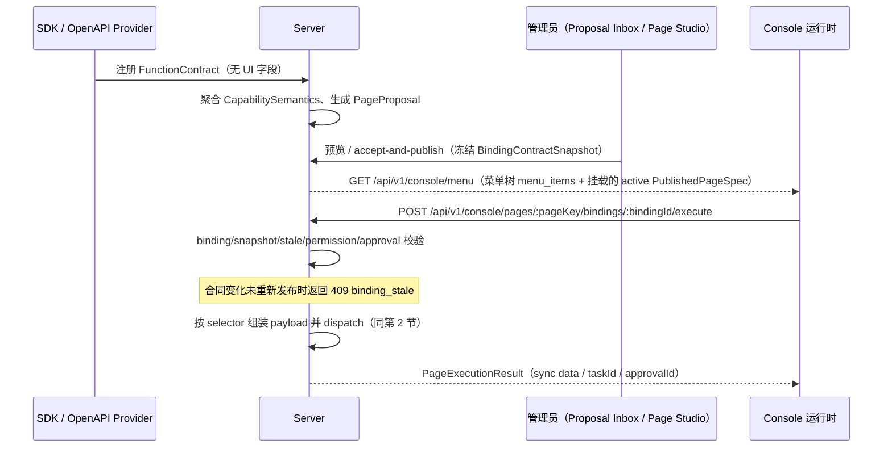
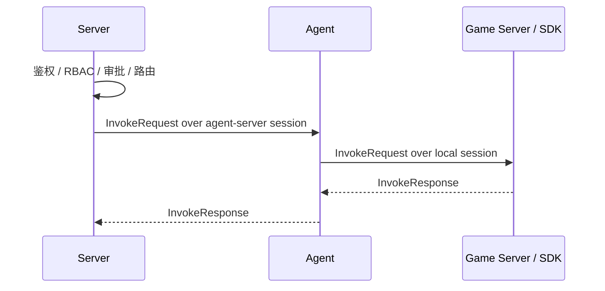
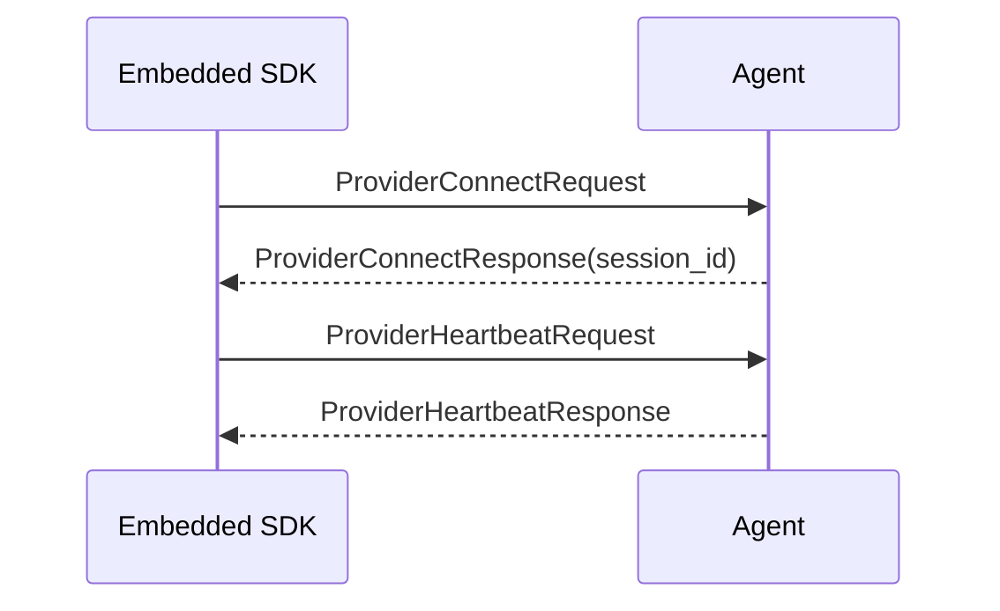
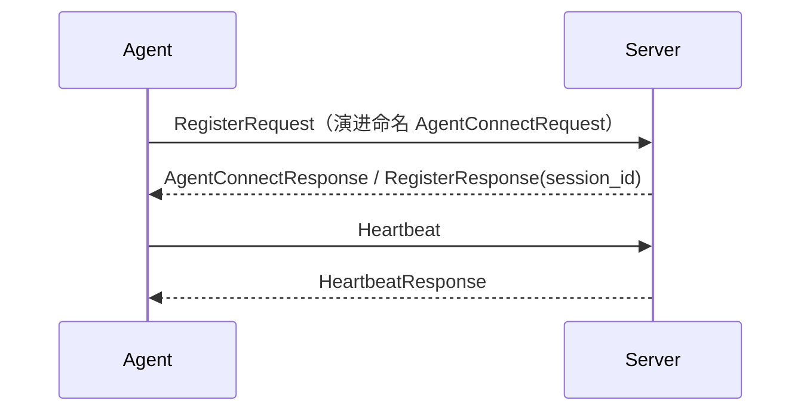
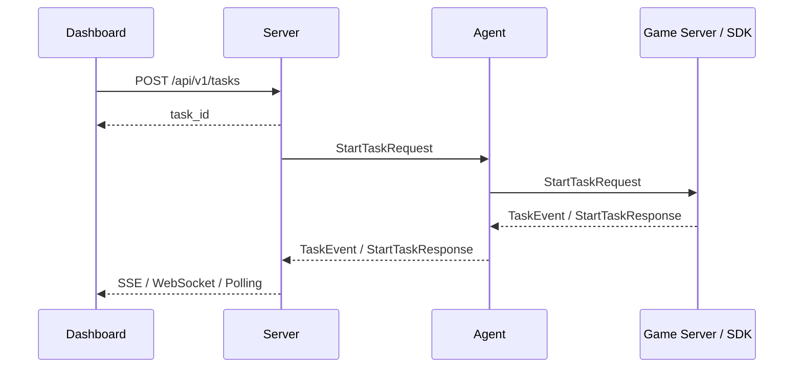

# Data flow

> **Status**: Current — the current implementation/specification, usable as an implementation reference.

This document describes only the main call flows under the current target architecture; the historical `gRPC/legacy-transport callback` model is no longer used.

## 1. Page publishing and governed execution (the vNext main path)

The main execution path for operator pages goes through the publish snapshot, not direct calls into the function catalog:



Key points:

- The browser submits only `bindingId` and the selector context (form/row/selection/page state); it never passes functionId, target, gameId, or env.
- The publish snapshot freezes the function version, schema digest, risk, permission, approval, and renderer version; re-registering a function produces only a new Proposal and stale diagnostics — a published page is never silently rewritten.
- Recovery after a contract change: `GET /api/v1/versioning/pages/:pageKey/diff` → three-way merge (presentation fields merge automatically, execution fields decided by a human) → republish.
- Direct function invocation `POST /api/v1/functions/:id/invoke` still exists, but is positioned as a debugging/management-plane path, not the main path for operator pages.

## 2. Server to business function (dispatch)



Key points:

- `Server -> Agent` no longer opens a separate callback connection
- `Agent -> App` is handled across the local session boundary
- Both legs follow the same session runtime model

### invoke routing: the provider/instance dual index

When one Agent fronts multiple game services, the Agent selects the target instance through a **Nacos-style two-layer index**:

- **At registration**: the SDK's `ProviderConnectRequest` carries `service_id` and `Metadata` (proto fields `sdk_language`/`sdk_version`/`game_id`/`env` etc.). The Agent registers a `functionId → serviceId → []Instance` two-layer index; instances carry `LastSeen` for health decisions (`internal/platform/agentlocal/store.go`).
- **At invocation**: `pickInstance` (`internal/agent/local_handler.go`) first fetches the service index by `functionId`; if the invoke metadata carries `serviceId` it lands precisely on that service's instance set, otherwise it merges the instances of every service under the function; it then filters healthy instances by `LastSeen` and load-balances.
- `Instance.Metadata` passes through SDK metadata (camelCase keys like `sdkLanguage`/`sdkVersion`/`gameId`), ultimately surfaced to opsNodes via `AgentProcess → ProviderSession`.

## 3. SDK registration to the Agent



## 4. Agent registration to the Server



### The SDK sliding version gate (function registration)

Each process in `RegisterRequest.processes` self-reports `sdk_language`/`sdk_version`. The Server records the historical highest SDK version per `(game_id, env, sdk_language)` (a **high-water mark**, persisted in each game database's `sdk_version_highwatermarks` table, numbered migration 0028) and applies a three-way decision at registration (`internal/platform/registry/sdkversion`):

| Decision       | Condition                             | Behavior                                                                                             |
| -------------- | -------------------------------------- | ----------------------------------------------------------------------------------------------------- |
| Allow          | version ≥ high-water mark              | After a successful registration, raise the high-water mark                                            |
| Allow + warn   | Same major, behind by 1 minor          | The function registers as usual; a `sdk_version_behind` registration warning is written               |
| Reject         | Behind by ≥2 minors or ≥1 major        | Functions exclusively declared by that process do not enter this registration (neither the session function set nor contracts materialize); a `sdk_version_floor_rejected` warning is written |

Detailed semantics:

- **Rejection granularity is the function, not the connection**: the rejected process's provider record still enters the session (the process's existence is a fact; the first dispatch-candidate gate is `agent.Functions`, so no mis-routing). When multiple processes cross-provide the same function, it is not removed as long as any allowed process also declares it — rejection never manufactures an availability gap.
- **Version parse failures (`"unknown"`/empty/non-numeric fields) always allow**, and never raise the high-water mark — the gate applies only when both ends are parseable semantic versions.
- Processes that do not self-report `sdk_language`/`sdk_version` (custom game servers connecting directly) are outside the gate.
- Rejections and behind warnings both return via `RegisterResponse.warnings` and are visible in agent-side logs; the connection stays up.

#### Configured minimum version (absolute floor)

Beyond the automatic high-water mark, a **minimum registrable version** can be configured per language (`registry.sdkVersionMinimums`):

```yaml
registry:
  sdkVersionMinimums:
    go: "0.3.0"
    python: "0.2.0"
```

A provider whose self-reported version is below the configured value does **not register** its exclusively declared functions (a `sdk_version_below_minimum` registration warning is written and returned via `RegisterResponse.warnings`; the connection stays up). Semantic key points:

- The configured gate is an **absolute floor that takes precedence over the sliding high-water decision** — it applies even when no high-water observation exists yet (first registration);
- Unconfigured languages use only the high-water gate; language keys are case-insensitive;
- As conservative as the high-water gate: not triggered when the self-reported version or the configured value fails to parse;
- Cross-provision protection is identical: a function also declared by any allowed process is not removed.

#### Function-level minimum version (UI, configured per function)

Beyond the language-level yaml, a minimum registrable **function version** can be set for a **single function** (compared against the function descriptor's own `version`, unrelated to the SDK version): the "version gate" card at the top of the function detail page's "change history" tab, or multi-select in the function catalog followed by "batch set gate" (`GET/PUT/DELETE /api/v1/functions/:id/version-floor` + batch endpoints; writes require `functions:manage`), persisted in the game database's `function_version_floors` table (numbered migration 0030).

- **Contract regression guard**: during a rolling-upgrade window, an old game server's re-registration would wash materialized contracts back to the old version (the main trigger of contract oscillation → stale pages); function declarations below the configured value do not materialize, a `function_version_below_minimum` registration warning is written (returned via `RegisterResponse.warnings`), and contracts never regress.
- **Decision granularity is the function**: judged per descriptor (the `version` of each entry in `req.Functions`); other qualifying functions in the same request register as usual; it does not depend on process self-reporting (also effective for pure game-server direct connections with no processes).
- **Orthogonal to the SDK version gate**: the SDK gate (high-water / language yaml) manages fleet upgrades; the function version gate manages contract non-regression; semantic-version comparison reuses the same `sdkversion` package.
- Stored decoupled from registration materialization in its own table: function rows upsert on re-registration, so platform settings are not washed away by descriptor writes; clearing performs a physical row delete (the unique index is not blocked by soft-delete leftovers).
- Function versions on the platform are always parseable semver: upstream registration validation already rejects empty/invalid versions with `invalid_version` (they never reach the gate); configured values are likewise validated parseable server-side before storage (`sdkversion.Parseable`).
- **Known boundary**: when the sole provider's version is below the gate, the function is unavailable (the warning is visible) — the direct consequence of the "below the configured value, do not register" semantics.

**Batch entry point (function catalog page)**: the typical scenario is closing out the gates for a batch of functions after a full SDK upgrade; visiting each detail page is unacceptable. The catalog table supports multi-select with a floating batch action bar ("batch set gate" / "batch clear"), plus a new "minimum function version" column echoing the current gate:

- Batch read: `GET /api/v1/functions/version-floors` → `{"floors": {functionId: minVersion}}` (all gates for the current game/env).
- Batch write: `POST /api/v1/functions/version-floor/batch`, body `{functionIds, minVersion}`; a non-empty minVersion upserts uniformly (the server validates the whole batch parseable first; invalid → 400 with zero writes), and an empty string is equivalent to DELETE per function (physical row delete). Write permission is the same as single-function (`functions:manage`).
- **Partial-success semantics**: per-function Set/Delete in a loop (both idempotent, retry-safe); the response is `{updated, failed, minVersion}`; failed lists the functionIds that failed and the frontend warns with the details. No transaction wrapper.
- If the catalog column fetch fails it degrades to not showing gates (`.catch(() => ({}))`), never blocking the function list.

**Known boundaries**:

- The high-water mark is a monotonic observation: after a high-version SDK is permanently retired, lower versions keep being rejected; resetting requires a manual `DELETE FROM sdk_version_highwatermarks WHERE ...`.
- The in-memory registry (no DB) degrades to an in-process map, lost on restart, re-accumulating from the first registration's version.
- Behind warnings (`sdk_version_behind`) are not auto-cleared after the SDK catches up (multi-language providers share the agent+code dimensions, so precise per-language cleanup is impossible); manual deletion is the fallback.
- Raising the high-water mark happens after `UpsertAgent` succeeds: a mid-registration failure never leaves a "not registered but already raised" state; conversely, if the process crashes after registration succeeds but before the raise, the high-water mark under-counts once and catches up on the next registration — no correctness impact.

#### Function removal grace (registration-side Removed)

Previously, a function disappearing from the registration side (game server shutdown / restart window / network flap / gate misconfiguration) would **immediately hard-delete** the contract and cascade-clean proposals, then re-create and rematerialize on re-registration — transient removals manufactured removed+created version noise and stale-page flapping. It now uses a two-phase **removal grace** (column `function_contracts.removal_pending_at`, numbered migration 0031):

- **Marking (inside the registration transaction)**: when `UpsertAgent`'s diff finds a function Removed with no surviving provider, the contract row is only marked `removal_pending_at = now` (repeat removals refresh the timestamp) — not deleted. Runtime availability takes effect immediately — the in-memory registry's `agent.Functions` no longer contains the function, call routing 503s right away, and the catalog instance count drops to zero.
- **Clearing (re-registration inside the grace window)**: when the function reappears on the registration side, the contract is rematerialized and `removal_pending_at` is cleared automatically. Zero version noise throughout; pages do not flap.
- **Sweeping (grace expired)**: a background loop (`StartBackgroundTasks`, same 5-minute interval as metric pruning / session cleanup) calls `SweepExpiredContractRemovals`, performing **conditional-delete atomic claims** on rows whose `removal_pending_at` predates the grace (default **10 minutes**, a package-level constant) (`DELETE ... WHERE removal_pending_at IS NOT NULL`; under HA only one instance's delete matches, so removed history is never double-written; rows re-registered inside the grace fall through the conditional delete and are never mis-deleted). After the hard delete it appends the removed version history (visible as a terminal state in the B2 change history), cleans standalone proposals, and — when the resource has no surviving contracts — removes the resource capability/semantics/resource-page proposals (same net effect as the immediate-removal path).
- **Cross-scope**: in database-per-game mode pending rows are scattered across the game databases, so sweeping closes out scope by scope per the `game_envs` bindings (a single-scope failure is logged and the round continues, retried next round); single-database mode sweeps all scopes at once.

**Known boundaries**:

- During the grace window (default 10 minutes) the contract row and proposals remain: runtime unavailability (calls 503) is governed by the in-memory registry, but the contract catalog / function detail still show the function's contract content (0 instances) inside the window; this is a direct consequence of the grace semantics, not a catalog bug.
- The grace duration is a package-level constant (`contractRemovalGracePeriod`) with no configuration knob for now; the sweep interval reuses the background loop's 5 minutes, so the actual latest deletion time ≈ removal time + grace + sweep interval.
- The `RemoveFunctionContract` immediate path remains only for internal OpenAPI-service use (cleaning up superseded unbound contracts, SDK-fallback reconcile); the registration side no longer triggers it.

## 5. Task flow



The operator-side TaskPage also goes through §1's binding execute: `task_status/task_events/task_result/task_cancel` each map to one binding; see the [Dashboard resource/page model](./dashboard-page-model.md) for the page model.

## 6. Managed processes and probing data flow (fed back by the three external reviews of 2026-10-14; live with R2-R4)

The probing/managed-process conclusions have been merged into the finalized Agent health monitoring and recovery review (the authoritative source); this section records only the data-flow-level positions.

### 6.1 The probing system's three layers and execution location

- **Layer 1 shared kernel**: `core/healthprobe` (the Checker contract / thresholds / two-state machine / failure windows / timelines) — one implementation, imported by all three agents and the server.
- **Layer 2 protocol probes**: http/tcp/process already exist; db converged from dbmon (R4); game protocols = a declarative skeleton (`ProtocolChecker`) + a per-game adapter (see the profile §5.5 for details).
- **Layer 3 execution location**: decided by perspective — **whoever's view is meaningful does the probing** (the probe point is co-located with the consumption point; agents provide the business network view, the server keeps its own dependencies and manual diagnostics). The sole authoritative source for the full division-of-labor table is the profile §4.2.

**Implementation layer ≠ instance layer**: one copy of the code (core) ≠ initiated from one place only ≠ probing the same targets; each target declares its perspective, and upstream events carry the agentID (execution location).

### 6.2 Desired-state coordination for managed processes (Reconciler — verification conclusion: **complete the existing mechanisms, add no new component**)

Source: the call chain proposed by the agent-lifecycle external review (2026-10-14), `Server → Desired → Task → Agent → Reconciler → {Scheduler, Supervisor, Updater, Config, Health}`. The review itself states "the Reconciler is a proposed new component, not something currently implemented"; this repo's verification verdict (2026-10-15) is **no new component**: the supervisor recovery loop is already the event-driven coordinator of the runtime-state surface (process exit events → backoff/breaker → restart, `ops_server.go` monitorProcess/superviseExit), and dispatch is the command-routing surface — this repo's counterpart of a "Reconciler" is precisely those two plus each capability surface's own desired-state source, landed capability by capability rather than as a centralized component.

The four state classes must be kept distinct (a review position, adopted): **runtime state / management state / scheduling state / update state** — conflating them produces misjudgments like reading "updating" as "stopped"; definitions in the [Agent Supervisor design](https://cuihairu.github.io/croupier/zh/design/agent-supervisor-design) §10.3. **The first block of management state is implemented** (2026-10-15): the operator's manual start/stop intent is persisted to the supervisor log directory's `desired_state.json`, and boot-time autostart consults it first (a process the operator stopped deliberately is no longer mis-started across agent restarts; a missing record = fail-open along the existing AutoRestart semantics with zero drift) — runtime/management states are now recorded separately; scheduling/update states land with their own capability surfaces.

### 6.3 Probe result upstreaming (an asymmetric policy, decided)

- Healthy state: aggregation/sampling rides the existing MetricsReport batch surface (precedent for folding probe samplers: `upstream.go:622,645`).
- Unhealthy state: failure details and window events go immediately over the SendAlertEvent event surface (the `probe.window`/`probe.detail` kinds); rate-limiting policy never affects the failure path.

## 7. Core principles

The current data flow follows these principles:

1. The control plane and the invocation plane converge uniformly onto session reuse; no more splitting into "a registration chain + a callback chain".
2. The `Agent`'s local listener faces only local integrators.
3. The `Server` routes to the right `Agent` via session ownership rather than dialing the `Agent` directly.
4. Business payloads stay JSON; platform control fields stay protobuf.
