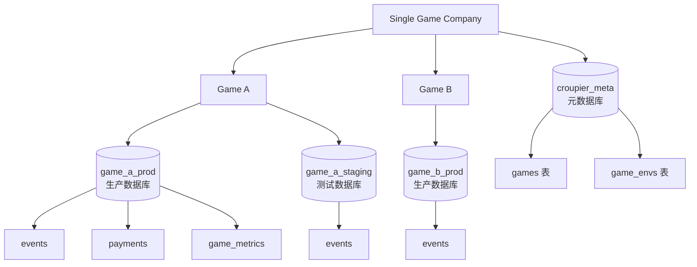
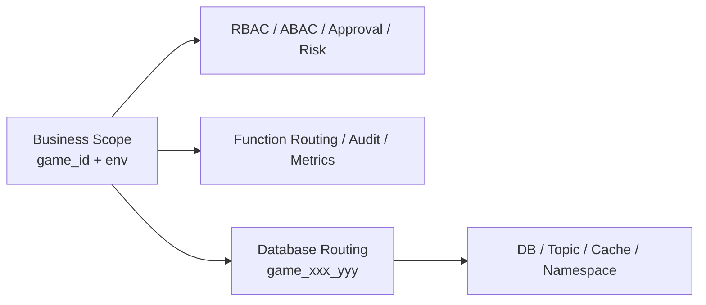

# Games and environment scopes

> **Status**: Target — the target specification for the game environment scope. Until the implementation completes, code reality does not get to rewrite this specification backwards; once migration lands, acceptance is measured against this document's acceptance conditions.

## 1. Design premise

Croupier is not a SaaS multi-tenant platform.

It serves by default:

- one game company
- several games inside the company
- several logical environments under each game

So Croupier's standard business boundary is not a `tenant`, but:

```text
scope = game_id + env
```

> Naming layering: this document uses `game_id` for the field's model/storage semantics (the proto field and the
> DB column share the name). Every contract surface uses lowerCamelCase `gameId` (REST/SDK contract keys, wire
> metadata), and the HTTP header is `X-Game-ID` — see CLAUDE.md's contract field naming rules.

## 2. Why `game_id + env`

`game_id` expresses business ownership.

`env` expresses the logical lifecycle stage, such as:

- `dev`
- `test`
- `staging`
- `prod`

Together these two fields cover exactly the most common isolation needs of a game-operations platform:

- permission control
- approval policies
- risk thresholds
- audit archiving
- staged rollout
- alerting and observability dimensions
- function routing

## 3. Database architecture: routing by game environment

Croupier's business isolation unit is always `(game_id, env)`. A deployment may choose single-database row-level isolation or physical per-game-environment databases; neither mode may change the API, authorization, or audit scope semantics.

When `multiGame: true`, Croupier uses the **database-per-game-environment architecture** — each game environment gets its own physical database.

### 3.1 Architecture sketch



### 3.2 Database organization

```
croupier_meta (元数据库)
├─ user_accounts
├─ role_records
├─ user_role_records
├─ role_perm_records
├─ games (游戏注册表)
├─ game_envs (环境注册表)
├─ message_records
└─ broadcast_message_records

game_demo_prod (游戏数据库)
├─ events (游戏事件，game_id 和 env 在数据库名中)
├─ payments (支付数据)
├─ game_metrics (游戏指标)
└─ server_id 索引支持 MMORPG 多服务器

game_demo_staging
└─ (同样的表结构)

game_rpg_prod
└─ ...
```

### 3.3 The advantages of per-game databases

- [Physical isolation, fully independent]
- [Independent capacity planning and scaling]
- [Simpler queries (no `WHERE game_id = 'xxx' AND env = 'prod'`)]
- [Easy game migration and archiving]
- [Fits the "common platform + per-game data" philosophy]
- [Supports MMORPG multi-server architectures (via server_id)]

## 4. Why not multi-tenancy

For Croupier's current scenario, introducing a `tenant` abstraction creates several problems:

- It entangles "the company boundary" with "the game boundary"
- It steers later permission/approval/routing design toward SaaS platforms
- It demotes `game_id` into a second-class concept, raising comprehension cost
- It forces policies that should be governed per game directly to detour through a layer

If multiple company instances ever truly exist, they should be handled by independent deployments or independent control planes — not by pre-embedding fake multi-tenancy in the current model.

## 5. Why not merge `game_id` and `env` into one field

We do not recommend merging the two into a single `scope_id` or `track_id` as the primary API field.

Reasons:

- Permission expressions naturally need to judge `game_id` and `env` separately
- Approvals, risk control, and observability usually issue policies per environment
- Querying, filtering, indexing, and aggregating are more natural with split fields
- Headers, logs, audit chains, and alert labels are also better served by independent fields

Composite keys may be derived for storage keys, cache keys, or topic keys, e.g.:

```text
scope_key = game_id + ":" + env
```

But they stay derived values; they must not replace the primary model.

`database_name` used to be listed among those derived values. It no longer is: the `game_envs.database_name` binding value is the **authoritative physical database name** for a scope (ARCH-006). Routing opens the database named by the binding — it never recomputes the prefix convention behind an existing binding's back. The prefix is only the default name applied when a binding is created.

## 6. `env` is not a deployment location

`env` expresses a logical environment only; it does not directly mean:

- a database instance (now explicitly designated by database_name)
- an Agent node
- a Kubernetes namespace
- a Redis DB
- an MQ topic
- a physical datacenter

Those are run targets or infrastructure boundaries and need their own modeling.

Under the per-game database architecture, each `(game_id, env)` combination maps to an independent physical database. The mapping's source of truth is the `game_envs` binding's `database_name` field; the prefix convention below is only what a NEW binding defaults to:

```text
game_id = "demo", env = "prod" → database = "game_demo_prod"        (default name)
game_id = "demo", env = "staging" → database = "game_demo_staging"  (default name)
game_id = "rpg", env = "prod" → database = "game_rpg_prod"          (default name)
# a binding whose database_name = "custom_rpg_db" routes to "custom_rpg_db",
# even if the configured prefix would recompute a different name.
```

## 7. Separating `scope` from `target`

The recommended model:



Meaning:

- `scope` decides which game and which environment something belongs to
- database routing locates the concrete database from `game_id + env`
- infrastructure policy is then decided by that database's own configuration

## 8. MMORPG multi-server support

For MMORPG games, the same game may span multiple servers/regions. Croupier supports this via the `server_id` field:

```sql
-- server_id in the events table
server_id LowCardinality(String) -- e.g. "s1", "s2", "asia1", "us_west_1"
```

Queries can aggregate by `server_id`:

```sql
SELECT server_id, count() AS player_count
FROM game_demo_prod.events
WHERE event = 'player.login'
  AND event_time >= today() - INTERVAL 7 DAY
GROUP BY server_id;
```

## 9. Commonality with open-source projects

This design is nothing exotic; many open-source products use a similar pattern:

- Unleash: `project + environment`
- Flagsmith: `project + environment`
- GrowthBook: `project + environment`
- Argo CD: business ownership separated from deployment targets

The common points:

- The business scope is modeled independently
- The environment stays a logical lifecycle concept
- Real deployment locations are expressed separately

## 10. Landing requirements for Croupier

The repository should follow these rules uniformly:

1. Stop describing `game_id + env` as "tenant / multi-tenant"
2. APIs, SDKs, permissions, and audit standardize on `game_id + env` as the canonical scope
3. When `multiGame: true`, the database layer routes to independent databases by `(game_id, env)`; when `multiGame: false`, single-database row-level isolation applies
4. All game business records keep both `game_id` and `env` columns; under physical splitting they are redundant validation and audit fields; in single-database mode they are the isolation condition
5. **Add `server_id` as a core field** to support MMORPG multi-server architectures
6. When a deployment location must be expressed, use separate fields such as `target`, `agent`, `node`, and `cluster`

## 11. The two-mode implementation

Croupier supports two run modes via the `database.multiGame` configuration:

### `multiGame: true` (recommended for production)

- Each `(game_id, env)` maps to an independent physical database (e.g. `game_demo_prod`)
- `internal/db/router.Router` lazily loads and caches per-game `*gorm.DB` connections
- `svc.GameDBMiddleware` parses the game scope from the `X-Game-ID` / `X-Env` headers and injects the DB into the request context
- Game data models obtain the correct DB from the context via `dbctx.Resolve(ctx, m.db)`
- The `game_id` / `env` columns in game tables are redundant (constant within a database), kept for code uniformity

### `multiGame: false` (default; development/CI)

- All tables coexist in the single configured database
- The `game_id` / `env` columns provide row-level isolation
- Router is nil and the middleware passes through
- Game data models use ServiceContext.DB directly (the meta DB doubles as the game DB)

Under both modes, the API-layer and model-layer code is identical; only connection management differs.

## 12. Authorization and request scope resolution

### 12.1 The minimal authorization unit

An administrator's accessible range takes `(admin_id, game_id, env)` as the minimal authorization unit. The meta database uses the `admin_game_env_scopes` table as the sole source of environment-level authorization:

```sql
admin_game_env_scopes
├─ admin_id       -- admins.id
├─ game_id        -- games.game_id，业务游戏标识，与 API 中的 game_id 一致
├─ env
├─ created_at
└─ updated_at

UNIQUE (admin_id, game_id, env)
INDEX  (admin_id, game_id, env)
```

Constraints:

- `game_id` uses the stable business identifier, not the internal game primary key that is easy to confuse with the API meaning; if an implementation must reference the internal primary key it should be named `game_pk` separately.
- `game_id` and `env` must both correspond to a registered, enabled game environment.
- An ordinary administrator with no authorization record has no game environment access; "no record" must **not** be interpreted as "access everything".
- Global administrator access can come only from an explicit global role or permission; the rule for bypassing the authorization table must be centralized in the authorization service, never scattered across handlers or empty-record SQL branches.
- No wildcard semantics such as `env = '*'` or an empty `env` are introduced. Granting several environments means writing several authorization rows explicitly, keeping query and revocation semantics simple and auditable.

If game-level authorization still exists because of a management UI, it may serve only as auxiliary data for batch-maintaining `admin_game_env_scopes`, never as a second source of truth for runtime authorization.

### 12.2 The decided scheme: stateless JWT with a persisted default scope

Croupier uses **stateless JWT + a persisted default scope + optional per-request override**, with no server-side session.

```text
登录 / 任意受保护请求
  → JWT 验签并解析 admin_id
  → 游戏环境相关请求：解析本次完整 header，或读取数据库默认 scope
  → 校验 (admin_id, game_id, env) 授权
  → 将 ResolvedScope 写入本次 request context
```

The responsibility boundaries:

| Data                           | Responsibility                                                  | Lifecycle                                                 |
| ------------------------------ | --------------------------------------------------------------- | --------------------------------------------------------- |
| JWT                            | Authenticate the caller (`admin_id`, roles, etc.)               | Within the token's validity; the server stores no session |
| `admin_game_env_scopes`        | Decide which game environments the user may access              | Persisted authorization data                              |
| `admins.last_game_id/last_env` | The default scope when the user specifies none                  | Persisted user preference; grants nothing                 |
| `X-Game-ID` / `X-Env`          | Override the default scope for a single request                 | Only the current HTTP request                             |
| `ResolvedScope`                | The sole scope used by business services, audit, and DB routing | Only the current request context                          |

The scheme keeps HTTP/JWT stateless: the server maintains no "current game environment" in memory or Redis, so it scales horizontally and a restart loses nothing. What is persisted is a user preference, not session state.

The reason "rely solely on a single server-side current scope" was rejected is that multiple tabs and devices would overwrite each other: a user may view `game-a/prod` in tab A while viewing `game-b/test` in tab B. The optional full headers describe only the current request, avoiding writing that concurrent context back into the user's default.

### 12.3 Alternatives compared

| Scheme                                              | Scope source                                      | Pros                                                                | Why not adopted, or the limitation                                                                                                      |
| --------------------------------------------------- | ------------------------------------------------- | ------------------------------------------------------------------- | --------------------------------------------------------------------------------------------------------------------------------------- |
| Headers only                                        | `X-Game-ID/X-Env` on every request                | No server state; easy one-off switches                              | The default lives only in the frontend; login and cross-device recovery are unreliable; every request depends on client state           |
| Stateful session                                    | The user's current scope in memory or Redis       | Clients need not send a scope                                       | Horizontal scaling needs a shared session; restarts and expiry need recovery; a single current scope is overwritten across tabs/devices |
| **Decided: JWT + default scope + optional headers** | Database default scope; full headers may override | No server session, recoverable, multi-tab and multi-device friendly | Needs one authorization check and clear header precedence; acceptable and necessary complexity                                          |

### 12.4 Persisting the last selection

The `admins` table gains nullable fields:

```text
last_game_id
last_env
```

They represent only the most recent successful selection in the user interface and grant no permission. These invariants must hold:

- Both fields are empty together, or they form a complete `(game_id, env)`; half a scope is never stored.
- Before saving, the scope must be verified to still be inside the current administrator's authorization set.
- Revoking that scope's authorization must synchronously clear the matching last selection; even if a cleanup is missed, reads must re-verify and never resurrect an invalid scope.

The login response returns the verified last selection:

```json
{
  "scope": { "gameId": "demo", "env": "prod" }
}
```

With no valid last selection it returns `null`. After a successful switch, `PATCH /api/v1/profile/scope` persists it; the body must contain both `gameId` and `env`, and the endpoint re-verifies authorization under the authenticated identity before updating the two fields.

### 12.5 Scope precedence for game-environment endpoints

Only endpoints declared "game-environment related" resolve a scope. The resolution order is fixed:

```text
完整 X-Game-ID + X-Env
  → 已授权的 last_game_id + last_env
  → 按稳定顺序（game_id, env）选择第一个已授权 scope
  → 无可访问 scope
```

Rules:

- When both headers are present, they must be validated as a unit — format, environment registration, and the current user's authorization; on pass they override only this request and **do not** update `last_game_id/last_env`. A failed check returns `403` without leaking whether the target scope exists.
- Only when both headers are absent may the persisted last selection or the first authorized scope be used.
- Sending only one of the two headers is an incomplete request and returns `400`; a header must never be stitched together with the last selection into a scope.
- The request scope is never completed from query parameters or the request body. They may identify a business resource, but they cannot substitute for this request's access context.
- With no accessible scope at all, return an explicit unauthorized error; the frontend shows "no accessible game environments" rather than picking an arbitrary game.

The resolver runs after authentication and writes the single `ResolvedScope` into the request context; database routing, permission checks, audit labels, and business services all read only that value. The database Router should not re-parse headers on its own — one request must never have two scope sources.

### 12.6 Scope-neutral endpoints

Authentication does not mean a game environment must be resolved. Endpoints group by route:

```text
所有受保护接口        → 认证中间件
游戏环境相关接口      → ScopeResolver → 授权校验 → 数据库路由
scope 中立接口        → 不读取、不恢复、不校验 game_id / env
```

Login, profile, the optional games list, authorization management, the audit log, and the global notification stream are scope-neutral endpoints. Even if a client attaches scope headers uniformly, these endpoints must ignore them; the headers must not trigger database routing or authorization failures.

Scope-neutral does not mean bypassing data authorization. `/api/v1/audit` must first verify `audit:read` (or a global administrator permission); a global administrator reads all audit records, while an ordinary user reads only records matching its full `admin_game_env_scopes` set. `gameId` and `env` on that endpoint are optional audit-record filters — not the request scope, and never a visibility expansion. Global audit records with no complete `(game_id, env)` attribution are visible only to global administrators.

### 12.7 The scope layers of function permission rules

Function permissions (`function_permissions`) have three scope layers that must be kept distinct:

1. **The function registration scope**: a function belongs to a definite `(game_id, env)` from the moment an agent registers it, and the registry routes by the `(game_id, function_id)` index. The function as seen in the catalog/detail page already carries its registration scope — not the question permission rules answer.
2. **The permission rule scope**: `function_permissions.GameID` / `Env` express "which call scopes this rule is effective in". Both columns empty = effective for all scopes (a global rule); filled = participates in judgment only when the calling request's scope (`X-Game-ID` / `X-Env`) matches. One `function_id` may register in multiple scopes; the rule-level scope distinguishes "allow only for a specific game/environment".
3. **Call-time validation matching**: the execution chain's `FunctionActionAllowed` matches rule scopes against the request scope (a rule carrying a scope while the request carries none is skipped, not counted).

**The current break (a known boundary, verified 2026-09-22)**: the function permission REST API (`GET/PUT /api/v1/functions/:id/permissions`) DTO carries only `resource/actions/roles` (`internal/api/function/dto.go`), with `gameId` / `env` **not wired** — the two fields on write requests are silently dropped at JSON binding, and read responses do not return them. So all function permission rules today are permanently global rules, and the gameId/env free-input boxes that once appeared on the function detail page's permission tab were dead fields (now removed). Until this break is wired, rule-level scope capability counts as unimplemented; when it is wired, the DTO and both read/write ends land in the same PR, and the UI presents controlled choices (the function's registered scopes or "all") — no free text.

## 13. API transport and SSE

### 13.1 The HTTP API

A game-environment API's request context is expressed by `ResolvedScope`; the service layer reads it only from the request context. `X-Game-ID` and `X-Env` are an optional, paired, single-request override; when both are missing, the server uses the verified default scope.

The frontend may attach the two headers uniformly via a request interceptor when the current page needs a pinned scope (especially multi-tab), but "always send the headers" must never become a correctness precondition. A single-tab default flow can rely purely on the server-recovered default scope.

Never pass the same request scope redundantly in query, body, and header for compatibility. The exception is scope-neutral APIs of the "manage a game or environment" kind: their `gameId` and `env` are the business resource fields being operated on, not the caller's current scope; they must be named with clear semantics in the DTO and authorized separately.

After login or an authorization refresh, the frontend first restores the server-returned scope, then issues game-environment requests; with no available scope it must not issue such requests. Scope-neutral requests do not depend on this step.

### 13.2 SSE is not limited by the current scope

`/api/v1/messages/stream` is scope-neutral: it requires authentication but **does not read** `X-Game-ID` or `X-Env`, nor does it fall back to the last selection. It returns the current user's messages across all authorized game environments, not just the currently selected one.

Notification messages are stored in the meta database, avoiding cross-game-database aggregation for one SSE connection. Messages must carry these attribution semantics:

- Game-environment messages must write both `game_id` and `env`; push and history queries both filter by the current user's authorized scope set.
- Global messages have `game_id` and `env` simultaneously empty; their visibility must have an explicit policy (e.g. all authenticated administrators), and a message missing exactly one field must never be treated as global.
- A database constraint is recommended: both fields empty together or both non-empty.

When a user's game-environment authorization changes, SSE permissions must not stay frozen at connect time. An authorization change must invalidate that user's authorization cache and actively disconnect their SSE connection; after reconnecting, the client re-subscribes under the new authorization set. Message fan-out must also filter by the current authorization set — never by a client-supplied scope alone.

The browser's native `EventSource` cannot set request headers. SSE authentication should use a protected same-origin session Cookie or the project's unified secure authentication mechanism; a long-lived JWT must never go into the URL query. Since SSE parses no scope, clients need not — and should not — pass one for it.

## 14. Agent scope binding (one game + one env)

> **Decision**: one Agent instance binds **one** `game_id + env`. The registration protocol (`RegisterRequest`) and the session model (registry session, cluster ownership table, audit) are all session-level single-valued. **Accepted — keep it simple; no multi-game/env binding.**

### 14.1 Why single-valued

| Dimension                     | Rationale                                                                                                                                                                              |
| ----------------------------- | -------------------------------------------------------------------------------------------------------------------------------------------------------------------------------------- |
| Network topology              | Agents deploy inside game networks; a game project's subnet/VPC/K8s cluster is naturally isolated — an Agent's reachable range is inherently one place                                 |
| Blast radius / attack surface | The Agent executes commands; one game per agent minimizes the blast radius of a credential leak                                                                                        |
| Audit and attribution         | The ownership table/audit chain queries Agent → (game_id, env) directly; the single-value model leaves "who is in which environment" unambiguous                                       |
| Operational autonomy          | Each game team upgrades/troubleshoots its own Agents without interference                                                                                                              |
| Cost                          | The Agent is a lightweight proxy; containerized multi-instance marginal cost is near zero — more games means more Agent deployments (the `agent`/`agent2` shape of the deploy compose) |

### 14.2 Hard constraint: env is always single-valued

`dev/test/prod` differ completely in databases (per-game routing), permission policies, approval thresholds, and audit sensitivity. One Agent bridging multiple envs means prod and non-prod networks joined and one credential leak exposing multiple environments — **no evolution may introduce multi-env binding**.

### 14.3 The standard practice for multi-game scenarios

When several games share infrastructure, **deploy multiple Agent instances** (one per game, possibly same host/cluster) rather than one Agent serving multiple games. `docker-compose.deploy.yml`'s `agent`/`agent2` is exactly this shape: independent AgentIDs, independent configs, each connecting through the L4 LB.

### 14.4 Evolution alternatives (recorded, not the current route)

The protocol layer's `AgentProcess.game_id/env` has reserved fields for per-provider scopes ("game scope the provider belongs to"). If the game count ever grows enough that per-game Agent deployment inside a shared cluster becomes a burden, provider-level scopes can land (function routing already has the `(game_id, function_id)` index; changes concentrate on registration aggregation and the ownership table's Agent×game granularity). Until then, not started.

### 14.5 Provider registration scope validation (the business-layer closed loop)

When an SDK/custom game server connects to an Agent (ProviderConnect) and when the Agent registers (Register's Processes), the provider-reported `game_id`/`env` must match the Agent session scope. A mismatch means an SDK-side configuration error (e.g. connected to the wrong environment's agent).

**Layering principle (Accepted)**: platform signals split into two layers by audience, and **the same event is never double-written across layers**:

| Layer          | Page                                               | Audience               | Carried content                                                                                                       | Lifecycle                                                           |
| -------------- | -------------------------------------------------- | ---------------------- | --------------------------------------------------------------------------------------------------------------------- | ------------------------------------------------------------------- |
| Business layer | `/system/functions/warnings` registration warnings | Developers/integrators | Integration contract issues: coded registration validation warnings like `invalid_version`, `provider_scope_mismatch` | Follows the registration act: a consistent registration auto-clears |
| Support layer  | `/ops/alerts` operations alerts                    | Operations             | Infrastructure health: resource thresholds, dbmon lock waits, etc.                                                    | firing→resolved state machine + silencing                           |

Rationale: **operations does not watch business integration issues, and developers do not watch support-layer information**. A scope mismatch is a business integration error whose "recovery" is simply the next consistent registration — it belongs to the business layer's own lifecycle and closes the loop inside the registration-warning system (a consistent registration clears the historical warning), never borrowing the ops alert's state machine.

Defenses and rules:

- **Agent startup hard validation**: `agent.gameId`/`agent.env` are mandatory; missing means a failed startup
- **The Agent's local defense**: ProviderConnect compares the provider scope vs the agent configuration, warninging back to the SDK
- **The Server's business-layer defense**: Register's `validateProviderScope` compares the Processes scope vs the agent session scope; a mismatch writes a registration warning (`code=provider_scope_mismatch`) and a consistent registration clears the historical warning
- **A hard cut, no compatibility**: a provider reporting no scope (empty values) also counts as a mismatch — SDKs must carry `game_id`/`env` explicitly; no empty-value skip branch survives
- **Heartbeat self-heal (the zombie defense)**: when the local registry session is unexpectedly lost but TCP is still alive, heartbeats previously kept succeeding silently, freezing the ownership row so the agent never self-healed — now the session is rebuilt by reading this instance's held scope back from the shared ownership table and re-Claiming (a scope not held by this instance is refused), so zombie sessions converge within ≤1 TTL
- **Routing semantics unchanged**: the ProviderSession aggregation still keys on the agent session scope (call routing stays stable); a mismatch only warns and never reroutes — the fix is correcting the SDK configuration, not the platform bending to a wrong scope

### 14.6 Review checklist

- Agent configuration/registration must never show a `games: []` multi-value shape; new capabilities must not bypass the session-level single scope
- The dual-agent deployment template (the deploy compose) must have consistent `gameId/env` (multiple access instances of the same environment; see the deploy workflow's scope sync logic)
- The cluster ownership table `cluster_agent_owners` keeps the (agent_id → game_id, env) single-value semantics
- A provider scope mismatch must never be silently rewritten or swallowed — it must enter the business layer's registration warnings (see §14.5); writing it cross-layer into ops alerts is forbidden
- Business-layer/support-layer signals are never double-written: a new signal first decides its audience (developer or operations) and then lands in the matching system

### 14.7 The four agent types' explicit attribution and back-office pages (2026-10-17)

The user has specified that all four agent types — sidecar/devops/capture/synthetics — must explicitly carry `gameId` and `env`, with corresponding back-office pages, all uniformly subject to §14's one-session-one-scope constraint; independent external plugins and third-party probes form no cross-scope exception.

| Contract surface                 | Rules that must be followed                                                                                                                                                                                                                                                                                       |
| -------------------------------- | ----------------------------------------------------------------------------------------------------------------------------------------------------------------------------------------------------------------------------------------------------------------------------------------------------------------- |
| Configuration and startup        | YAML/JSON uses `agent.gameId` and `agent.env`, both mandatory after whitespace trim, no implicit fallback to dev/prod/default; cross-game/environment uses independent instances, IDs, data directories, and credentials                                                                                          |
| Registration and session         | Proto uses `game_id/env`; the server validates that the registering identity is authorized for the game environment and then binds it fixedly; labels are descriptive only and cannot override; the same global Agent ID must not let an active connection override across scopes                                 |
| Heartbeat, reconnect, and HA     | Inherits the registration identity; forwarding and owner recovery preserve the bound attribution; switching game environments deploys a new instance identity and cleans old routes; editing attribution from a page is unsupported                                                                               |
| Configuration delivery and tasks | Targets, functions, processes, hosts, collection sources, probe plugins, and credential references must belong to the same scope; ownerAgentId does not substitute for an attribution check; cross-scope assignment is forbidden                                                                                  |
| Upstream and storage             | Statistics, windows, alerts, audit, execution records, offsets, logs, and recording indexes explicitly retain the Agent scope, with authority from the bound session/persistent identity; plugin output cannot re-attribute itself — conflicts are rejected and logged as contract errors                         |
| Queries and actions              | Reuses ResolvedScope; reads, aggregation, control, download, and replay verify authorization and target attribution first, consistently across local/cluster/fallback/offline queries; a target not found within the legal current scope returns 404 uniformly, never leaking other scopes                        |
| Pages and cache                  | Page headers, per-row, detail, and confirmation dialogs all show gameId/env; requests determine scope via §13.1's context/header contract, never duplicated into query/body; on switch, old data/actions are cleared, cache keys include the scope, and stale responses never write back into the new environment |

Legacy or migrating records lacking attribution must not enter the four business pages, and a record missing one field is never treated as global; historical diagnostics stay in the authorization-guarded platform logs. While an Agent is offline, history is queried by the persisted last-known scope and collection time, with the page marked stale and real-time control disabled.

The four pages are the target design for `/ops/agents/sidecar`, `/ops/agents/devops`, `/ops/agents/capture`, and `/ops/agents/synthetics`; entry points, fields, permissions, data requirements, and delivery batches are in the [Agent back-office page design](https://cuihairu.github.io/croupier/zh/design/agent-dashboard-design); currently unimplemented new entry points must not be labeled as delivered.

**Current implementation gaps**: devops/capture configuration validation, the ops Agent's local list filtering, and the DB probe's owner-derived registration scope filtering have been closed out; the four agent types' (sidecar/devops/capture/synthetics) configuration and registration explicitly carrying non-empty gameId/env plus the server identity binding (TCP registration pre-check rejecting empty/whitespace normalization, cross-scope session Upsert rejection, same-ID conflicts failing closed, per-message upstream normalization) have also been fixed to the same standard with four-type cross-package consistency tests (2026-10-20). The unified back-office pages for the four agent types and the complete attribution matrix over targets, processes, hosts, configuration delivery, and tasks still await later batches and must not be treated as done wholesale.

## 15. Migration and acceptance order

1. Establish `admin_game_env_scopes`'s unique constraint and authorization queries; when migrating existing authorization data, expand explicitly into environment-level authorization rows.
2. Add `last_game_id` and `last_env` to `admins`, and clean out incomplete or no-longer-authorized historical values.
3. Implement and test the scope-neutral route group, `ScopeResolver`, the authorization check, and the database routing's fixed order.
4. Add `PATCH /api/v1/profile/scope`, return the verified scope in the login response, and verify every branch: complete, missing, revoked, and unauthorized users.
5. Remove the request scope's query/body duplication from game-environment APIs; keep business resource fields with clear names.
6. Add the messages' scope attribution rules and complete SSE's full-authorization-set filtering, revocation disconnection, and reconnection tests.
7. Acceptance: forged headers, half a header, an invalid last selection, post-revocation SSE, unauthorized users, global messages, and messages spanning multiple authorized environments must all have automated tests.
