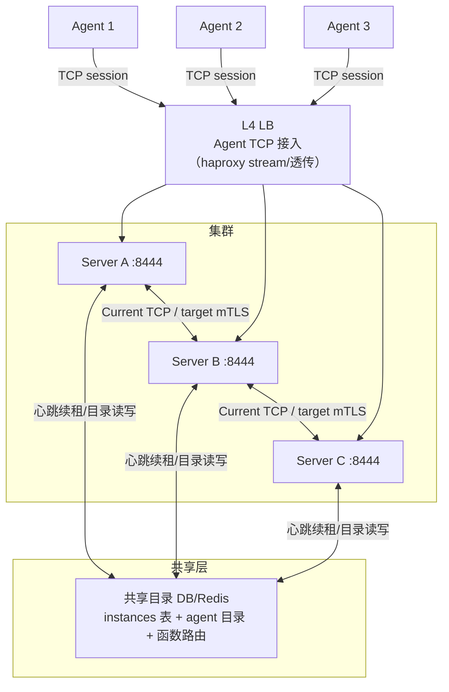

# Server multi-instance high availability design

> **Status**: Implemented — the membership table (reusing RegistryStore self-registration + leases), the instance interconnect and owner forwarding (including fencing epoch / one-hop loop prevention), the `cluster.enabled` wiring, and the cluster topology page have all landed; tests in `internal/cluster/`. For deployment shapes (L4 LB / multi-homing / K8s) see the load balancing guide.
>
> **Call-path completion (2026-09-11)**: read-path aggregation (the `/functions/instances` family now reads the shared ownership table) and owner forwarding on the write/call paths have both landed — synchronous invoke, async tasks (`start_task`), task cancellation (`cancel_task`), and broadcast share one forwarded frame (§5.4 `kind`); when the dispatcher's local candidate set is empty or failover has exhausted local candidates, it backfills remote candidates via the shared ownership table + the `agent_sessions` snapshot table (RemoteAgentSource, a 1s budget, degrading on error) and then forwards (§5.5); cross-instance task cancellation resolves the agent from the shared `task_runs`. The `refreshRemoteSnapshots` 30s backfill is demoted to a performance-optimization layer. For active-active switchover steps and the remaining known boundaries (mesh plaintext, hash placement, etc.) see the load balancing guide's "deployment mode constraints".

This document defines the target design for evolving the Croupier Server control plane from a single instance to a multi-instance high-availability (HA) deployment, covering problem analysis, option selection, the shared directory, the instance interconnect, the forwarding protocol, failure semantics, and the implementation breakdown.

## 1. Background and problem

The current Server control plane is a **single point**:

- Agent sessions and the function routing table live in process-local maps in `internal/platform/registry/store.go` (RWMutex-protected)
- The Agent-Server link is a physically pinned TCP session long connection
- The `dispatch` layer's `NewDispatcherWithHA` solves only the "which Agent to pick" kind of HA, not the Server's own

Three consequences:

1. **Crash = the whole platform stops**: while a Server crashes or restarts for upgrade, the registry is lost and every Agent disconnects; GM capabilities are entirely unavailable
2. **No horizontal scaling**: with two Servers deployed, load balancing sends requests to an instance that does not own the target Agent, and the in-memory registry lookup fails the call (a split-brain-style error)
3. **No rolling upgrades**: every release carries a whole-platform outage window

## 2. Goals and non-goals

### Goals

- Shrink the Server crash blast radius from "the whole platform is down" to "second-level interruption for the Agents owned by that instance + automatic failover"
- HTTP read paths (permissions, audit, data browsing) stay fully available on any surviving instance
- Support rolling restart/upgrade with zero user-visible impact
- Keep the single-instance experience unchanged: no new external component is forced in

### Non-goals

- We do not chase "connections never break" — when the process holding a connection dies, the TCP connection breaks; HA guarantees **contained impact and reconnection**; memory approvals, in-flight tasks and events do not have complete recovery guarantees
- No SaaS multi-tenant scaling; the fleet is expected at 2~5 instances
- The Agent's outbound connection model does not change (the game-network "outbound only, no inbound" security constraint stays)

## 3. Option selection

### 3.1 Choosing the shared state mechanism

Multi-instance coordination needs a mechanism for "sharing state / reaching agreement across instances". Candidate routes:

| Route                                                | New dependency | Assessment                                                                                                  |
| ---------------------------------------------------- | -------------- | ----------------------------------------------------------------------------------------------------------- |
| A. Reuse the existing DB (MySQL/PG) for the registry | None           | The passable baseline; heartbeat writes need rate reduction/batching                                        |
| B. Redis for the registry                            | Redis          | The industry-standard approach; natural TTL/pub-sub; the repo's cache/MQ already have Redis implementations |
| C. Embedded consensus (Raft/gossip)                  | None           | Hand-developing distributed logic costs too much; over-engineering for this project's scale                 |
| D. L4 sticky routing + reconnect re-registration     | None           | Smallest change but unbalanced load and a failover gap; transition only                                     |

**Conclusion**: the `RegistryStore` abstraction + multiple implementations, reusing the repo's existing pluggable-storage pattern (cache's local/redis/null, MQ's redis/kafka/noop, RateLimitStore).

### 3.1.1 Industry pattern comparison: reverse-tunnel agents + a replicated control plane

This problem is a classic difficulty in distributed systems: "with a reverse-tunnel agent and a replicated control plane, how does a request find the instance holding the connection". The industry has five mature patterns, all backed by open-source projects:

**Pattern 1: a message bus as the routing layer (a standalone connection-management layer)**

Representative: **Pitaya** (topfreegames, a Go game-server framework).

```text
GameServer ──► Edge（连接层，只持有连接）◄──► NATS（消息总线）◄──► Logic Server（业务层）
                      ▲                         ▲
                   etcd（服务发现）─────────────┘
```

Frontend servers hold only connections; business servers send RPCs over NATS, and the bus routes each message to the connection holder subscribed to the corresponding subject; service discovery uses etcd. No explicit forwarding code.

- **Unique benefit**: business-layer restarts/upgrades never drop Agent connections (connections live in the Edge layer; the business layer is stateless)
- **Cost**: NATS becomes mandatory (and itself needs clustering — a new critical path) + etcd; all call traffic crosses the bus (bandwidth amplification, one extra hop of latency); one more black box in troubleshooting

**Pattern 2: the Agent connects to every replica**

Representative: **Teleport ≤ v10**. The Agent keeps one reverse tunnel to every Proxy; any Proxy has a direct path; zero forwarding.

- Pros: zero routing logic, lowest latency
- Cons: N×M connections, heavier Agents, and one Proxy restart triggers a full-agent reconnect thundering herd
- **Key evidence: Teleport itself abandoned this pattern in v11**, moving to pattern 3 (connection storms are unbearable at fleet scale)

**Pattern 3: shared directory + inter-instance forwarding**

Representative: **Teleport v11+ (Proxy Peering)**. The Agent connects to one Proxy; Proxies forward among themselves. This is this document's design (chapters 4 and 5).

**Pattern 4: caller-side routing**

Representatives: **Tailscale DERP**, **Kubernetes Konnectivity**. No forwarding; the control-plane directory tells the caller "which instance holds the target connection", and the caller connects to that instance itself to deliver (Konnectivity: the apiserver keeps connections to all konnectivity-server replicas, picks the target replica by hashing the agentID, and re-resolves and retries on a miss).

- Mapped to Croupier: the ingress gateway routes HTTP requests to the owner instance by consistent hashing on `gameId`/`agentId`
- Pros: no forwarding code, no hop latency
- Cons: complexity moves into the gateway/LB layer; the hash mapping must follow Agent reconnections that change instances; the gateway itself becomes a critical component

**Pattern 5: single-point tunnel + external fallback**

Representatives: **frp, rathole**. The tunnel server is a single point, backstopped by keepalived/multi-ingress + client reconnection. Croupier's status quo is essentially this class.

**The five patterns compared**:

| Dimension                                | ① Pitaya bus                        | ② Agent connects to all  | ③ Directory + forwarding     | ④ Caller routing      | ⑤ Single point + fallback |
| ---------------------------------------- | ----------------------------------- | ------------------------ | ---------------------------- | --------------------- | ------------------------- |
| New infrastructure                       | NATS + etcd                         | None                     | None (reuses DB/Redis)       | A smart gateway       | None                      |
| Agent change                             | None                                | Large (many connections) | None                         | None                  | None                      |
| Server change                            | Split edge/logic layers             | Small                    | Medium (forwarding protocol) | Small                 | None                      |
| Business restart drops Agent connections | Never                               | Partially                | Only that instance's         | Only that instance's  | All                       |
| Call latency                             | +1 hop (the bus)                    | Direct                   | Possibly +1 hop              | Direct                | Direct                    |
| Failure blast radius                     | Bus failure = global                | 1/M                      | 1/M                          | 1/M                   | Global                    |
| Scale ceiling                            | High                                | Low (connection storms)  | Medium-high                  | Medium                | —                         |
| Industry validation                      | Large-scale game-backend production | Abandoned by Teleport    | Teleport's current design    | Tailscale/K8s current | Small teams               |

**Selection conclusion**:

- **Pattern ③ for now**: no new component, zero Agent change, and Teleport's evolution path (②→③) provides production-scale endorsement
- **Pattern ① stays as the end-state evolution option**: when instance count grows and release frequency makes "second-level interruption" unacceptable, upgrade to the edge/logic two-layer + bus routing. Pattern ③'s shared directory and fencing design is **not wasted** even then — the bus mode still needs them
- Pattern ② has been rejected by Teleport; pattern ④ means hand-building a smart gateway, a poor input/output trade

### 3.2 The key design decision: explicit configuration, no database-driver coupling

The storage implementation **must not** switch implicitly on `database.driver` (guesses like sqlite→memory, mysql→redis). Why:

- Database type ≠ deployment shape: single-instance MySQL deployments are common and must not be forced to require Redis
- Implicit switching produces "surprise behavior": the same config changes runtime behavior by flipping a driver — a troubleshooting nightmare
- The right way: explicit configuration + conservative defaults + fail-fast validation at startup

```yaml
registry:
  store: memory # memory | db | redis，默认 memory
  redis:
    addr: localhost:6379
    keyPrefix: "croupier:registry:"
```

Validation rules (wired into the existing `config validate` entry point):

- `store: memory`: log a warning at startup — "single-instance registry; a multi-replica deployment will mis-route functions"
- `store: redis` without `addr`: error at startup
- `store: db`: reuse `database.dataSource`, zero new dependencies

## 4. Overall architecture



> **Two entry types, two LB layers** (a common confusion): the Agents' TCP long connections go through L4
> (haproxy/nginx stream, layer-4 passthrough, spread by active sessions); the Dashboard HTTP
> API goes through L7 (nginx reverse proxy + split_clients). Their duties differ and cannot be merged —
> the ops center's dashboards/actions reach any instance over L7 (stateless routing), while Agent sessions
> are spread by L4 and backstopped by owner-forwarding semantics. See the deployment doc's "load balancing option selection".

````

### 4.1 State layering: what can be shared, what must stay local

Registry state falls into two classes that must be separated:

| Content                                                            | Location                              |
| ------------------------------------------------------------------- | --------------------------------------- |
| Agent metadata (ID, game/env, health score, heartbeat time)          | Shared directory                        |
| The function routing table (functionId → agentId → ownerInstance)    | Shared directory                        |
| **The TCP connection handle (net.Conn)**                             | **This process's memory; not shareable** |

What is shared is precisely a "**directory service**" (who is online, with what capabilities, connected to which instance); the connection table always stays local.

### 4.2 Why inter-instance forwarding (not Server-to-Agent direct dialing)

Agents deploy in the game VPC/intranet with an "outbound only, no inbound" security policy; the tunnel direction is Agent → Server. The directory can record Agent ownership, but it **cannot conjure a network path from other instances straight to the Agent**. So when a non-owner instance receives a call request, it must ask the owner to deliver it over the interconnect — the standard solution of reverse-tunnel architectures (frp, konnectivity, Azure Relay).

Rejected alternatives:

- **Server dials the Agent directly (Server → Agent dial-out)**: requires opening inbound firewall rules in the game network, overturning the security model, and the Agent must handle concurrent connections from multiple Servers — an order of magnitude more change than forwarding
- **A full Agent connection mesh (connect to every Server)**: N×M connection storms and registration storms, plus consistency coordination of task cancellation/idempotency/event sequence numbers across sessions that far exceeds forwarding's complexity
- **Pure sticky routing**: transition only; poor rebalancing on scale-out and poor failover quality

## 5. Interconnect design

### 5.0 The Interconnect abstraction (the implementation foundation)

The interconnect layer is abstracted as the `internal/cluster.Interconnect` interface — forwarding logic (owner discovery,
connection establishment/reuse, the one-hop limit, fencing) is fully encapsulated inside the implementation; the dispatch layer depends only on the interface:

```go
type Interconnect interface {
    // Forward 把调用请求转给持有目标 Agent 连接的实例。
    Forward(ctx context.Context, agentID string, req *ForwardedInvoke) (*ForwardedResult, error)
    // Peers 返回当前已知存活对端（诊断/测试）。
    Peers() []PeerInfo
}
````

This is not introducing a real broker component (a NATS-class bus is pattern ①'end-state evolution); forwarding itself is
the "broker". The value of the interface: callers are oblivious, implementations are swappable (upgrading pattern ③→① does not touch callers),
and tests can verify forwarding semantics with a stand-in.

### 5.1 Instance identity and discovery: the shared directory — no seeds, no static peers

**Conclusion: no seed nodes and no static peer list.**

Rationale: seeds/gossip are the solution for "cluster self-organization when there is no external shared store" (Cassandra uses gossip only because it has nowhere to put a membership table); this design's multi-instance mode **mandates the shared directory** (RegistryStore's DB/Redis), and the membership table `instances` lives right there — a single source of truth, zero new dependencies:

```
启动 → 写 instances 记录（advertiseAddr + 租约 + epoch）→ 轮询表发现对端 → 懒建连
```

- Scaling to a 5th instance: self-registration is discovered by the others; no configuration changes
- Each instance's only mandatory unique config is its own advertised address; the shared store address already exists at `registry.store` — not a new "seed"
- No second static membership table is maintained (it would drift from `instances`)

```yaml
cluster:
  enabled: true
  instanceId: "" # 空则自动生成 UUID
  advertiseAddr: "10.0.1.11:8444" # 唯一必填：告诉对端怎么连我
  heartbeatInterval: 5s
  leaseTtl: 15s # 3 个心跳周期
```

Each Server writes its `instances` record at startup and renews it periodically:

```json
{
  "instanceId": "server-a-7f3d",
  "advertiseAddr": "10.0.1.11:8444",
  "startedAt": "...",
  "leaseExpireAt": "...",
  "epoch": 42
}
```

- `instanceId`: configurable; a UUID is generated at startup when empty
- `epoch`: a term number incremented on every startup, serving as the **fencing token**
- Lease TTL expiry (3 heartbeat periods recommended) marks the instance dead

**Edge cases**:

- Shared-store jitter: a local last-known-peers cache keeps forwarding; degradation affects only new-member discovery
- Store vs. reality disagreement: the lease TTL + epoch adjudicate
- A misconfigured advertiseAddr (e.g. 127.0.0.1): self-check after registration (dial from a peer's perspective to verify reachability); an unreachable address raises a startup alarm

### 5.2 Topology and transport

- **Lazy full-mesh connections (lazy mesh)**: a connection to a peer is established on first forwarding need and pooled afterwards; at 2~5 instances, mesh suffices
- **Reuse the in-house session transport foundation** (`internal/transport/tcp`), adding a third handshake role:

```text
握手消息: { role: "server", instanceId: "server-b", epoch: 17 }
```

- No RPC framework is introduced (consistent with the transport layer decision — see the legacy sdk-agent/agent-server transport decision records)
- Bidirectional multiplexing naturally supports forwarded task event streams (progress/log events must pass back through the forwarding layer to the SSE caller)
- **A dedicated listen port** (e.g. 8444), separate from the Agent-facing port; the firewall allows only the cluster's intranet segment

### 5.3 Interconnect security

Implemented (ARCH-003, 2026-10-31):

- **Design**: reuse the existing mTLS CA (devcert/tlsutil/certificate monitoring); the interconnect port accepts only peer certificates with `role = server`; Agent certificates are rejected outright
- **Implementation**: `cluster.interconnectTls` is a dedicated certificate surface (`certFile`/`keyFile`/`caFile`/`serverName`). When all three certificate fields are set and `insecureSkipTls` is false, the interconnect uses mTLS with a `VerifyConnection` hook (`internal/cluster/identity.go`) that rejects any peer whose leaf certificate lacks the dual `ServerAuth`+`ClientAuth` extended key usages (the "server role") or an empty CommonName. Agent certificates (ClientAuth only) are rejected outright. `devcert.EnsureInterconnectCert` issues the dual-EKU cert. A handshake gate (`ServeHelloHandler` marks the per-connection session, `ServeForwardHandler` rejects unhandshaked forward) ensures identity binding precedes any forward. The epoch fencing (iron law two) is unchanged and still enforced on the same connection. When certificate fields are incomplete or `insecureSkipTls` is true, the interconnect keeps the intranet plaintext TCP path for backward compatibility, recorded in the readiness surface as a degrade.
- **Trust boundary**: when the certificate surface is unset the interconnect port (interconnectAddr) must remain reachable only from the cluster intranet and must not touch the public internet.
- **The owner does not re-check policy/approval (an implementation decision, departing from the early design)**: forwarded requests carry the original caller's context (username/roles/adminId/traceId), but the owner only writes audit, never re-executes permission checks. Rationale: the caller has already completed the full authorization chain (policy hit + the approval-resumed second call arriving at the owner via forwarding); an owner re-check would deadlock the approval resume because the approval context lives on another instance. This decision rests on the same premise — "the interconnect port is cluster-intranet only" — intranet instances are treated as trusted
- Owner-side audit: every forwarded delivery (success or failure) writes one `function.invoke` audit (same keys as the caller-side audit; details carry `forwarded: true` / `kind` / `agent_id`). The audit hash chain's sequence allocation collides on the unique constraint under multi-instance concurrency (each instance's memCache view is independent) — when `AuditService.Log` detects a chain conflict it re-reads the shared database's true chain tail, recomputes sequence/prev/hash, and retries (≤3 times); the unique constraint backstop guarantees only rows correctly chaining from the tail can land, so chain integrity does not fork across instances; exhausted retries leave a Warn log

### 5.4 The forwarding protocol and the two iron laws

A new internal message `MsgForwardInvokeReq (0x060103)`. **Implementation deviation**: the frame body is `ForwardedInvoke` as JSON (not a protobuf envelope; an internal protocol, lowerCamelCase field names); `forwarded`/`callerEpoch` are stamped uniformly by `Interconnect.Forward` and validated uniformly by `ServeForwardHandler` — callers do not fill them.

```json
{
  "agentId": "…",
  "functionId": "…",
  "payload": "<proto 字节，base64>",
  "metadata": { "gameId": "…", "env": "…", "taskId": "…" },
  "idempotencyKey": "…",
  "kind": "",
  "taskId": "…",
  "forwarded": false,
  "callerEpoch": 42,
  "caller": {
    "adminId": 1,
    "username": "…",
    "roles": ["…"],
    "gameId": "…",
    "env": "…",
    "traceId": "…"
  },
  "timeoutMs": 0
}
```

- `kind` distinguishes three forwarded call types: `""` (synchronous invoke, the first consumer, backward compatible) / `start_task` (async task delivery) / `cancel_task` (task cancellation). Loop prevention / fencing / stamping are shared by all three
- `taskId` is used only by `cancel_task` (the target task); `start_task`'s server-side task ID rides in `metadata.taskId` per the InvokeRequest semantics (the agent side parses the same path)
- The `timeoutMs` field is reserved but unused (the caller's ctx deadline governs)

**Iron law one: at most one hop.** If a request with `forwarded: true` reaches an "owner" that discovers it is not the owner after all (a stale directory), it **must not forward again**; it returns a `not_owner` error and the caller re-resolves the directory and retries. This kills forwarding loops.

**Iron law two: fencing validation.** Before executing, the owner compares the directory's epoch with its local epoch; if the directory shows a newer instance has taken over the Agent, it is a "zombie owner" revived from a network partition and must refuse to execute. This prevents split-brain double writes.

### 5.5 The complete call path and the division of responsibility

```text
1. 运营人员请求落到任意 Server B
2. B 查共享目录: function X → agent-1 → owner = A, epoch = 42
3. B 懒建立/复用到 A 的互联连接，发 ForwardInvoke（携带 caller 上下文）
4. A 校验: 我是 owner 吗？epoch 匹配吗？
5. A 走本地既有 dispatch 路径，通过隧道发给 agent-1
6. 结果经 A → 互联连接 → B 回运营人员；异步任务事件经 A 落共享库
  （task_events），B 的 HTTP 轮询/SSE 从共享库读取——事件不走 mesh
```

Fully transparent to the caller.

The caller/owner division of responsibility for the three call paths:

| Responsibility    | Caller instance (the HTTP entry)                                                                                                                                                              | Owner instance (holding the agent connection)                                                            |
| ----------------- | --------------------------------------------------------------------------------------------------------------------------------------------------------------------------------------------- | -------------------------------------------------------------------------------------------------------- |
| Candidate set     | The local registry; on empty, fall back to the ownership table                                                                                                                                | — (the forwarded request already names the agent)                                                        |
| Policy / approval | The full authorization chain (policy hit + approval creation)                                                                                                                                 | **No re-check**, audit only                                                                              |
| Sync invoke       | Failed calls retry with other candidates (failover)                                                                                                                                           | `InvokeRequestOnAgent` targeted delivery                                                                 |
| async start_task  | Mint the server task ID + write the task_runs row + registerTask + return the task ID on success; failover identical to invoke (failures mark the attempt row failed, exhaustion maps to 503) | `StartTaskOnAgent` delivers only (metadata.taskId reuses the caller's ID; no row, no route registration) |
| broadcast         | Candidate set local ∪ remote (deduped, local first); partial failures land in Failures (HTTP 200)                                                                                             | Forward-delivered per agent, same as invoke                                                              |
| cancel_task       | On a task-routing miss, resolve the agent from the shared task_runs; unregisterTask after success                                                                                             | `CancelTaskOnAgent` delivers only; post-cancellation route cleanup happens on the caller                 |
| Task events       | HTTP polling/SSE reads the shared store                                                                                                                                                       | Agent events land in the shared store (task_events)                                                      |

The candidate-set fallback (RemoteAgentSource): when the local candidate set is empty (or failover has exhausted local candidates), synchronously query the shared ownership table + the `agent_sessions` snapshot table (1s budget; degrade on error rather than amplify the failure) to backfill remote candidates; the chosen remote candidate executes via forwarding. The 30s periodic backfill of `refreshRemoteSnapshots` is thereby demoted from a correctness dependency to a performance-optimization layer.

The registry's in-memory session lifecycle aligns with the ownership table (no row means cleared): the entry is deleted the moment this instance's connection drops (the `RemoveAgentIfStale` notAfter check blocks the race against a reconnect-registering session), restart recovery filters snapshot rows against the ownership table's active set, and the 30s reconciliation cycle clears orphan copies whose "ownership table has no row and LastSeen exceeds the 5min grace (> ownerTTL 3min, preventing Touch jitter mis-deletes)" — no ownership row = no instance holds the connection, and the in-memory entry dies with it. The DB's `agent_sessions` snapshot rows are neither deleted nor updated; they expire naturally, avoiding an Upsert write race with reconnection registration.

## 6. Failure semantics

### 6.1 Connection distribution

In a multi-replica deployment, Agent connections are **spread** by the L4 LB across instances; a single instance failure directly affects only its own 1/M of Agents.

### 6.2 The failover timeline

```text
t=0s      Server A 宕机，A 名下 Agent 的 TCP 断开
t≤1 周期  Agent 心跳循环发现断连（Connected()=false）→ 立即重新拨号；
          网络半开（无 RST）时需连续 2 次心跳失败 ≈2 个周期才判死
t+拨号    经 L4 LB 重连，分发到存活实例 B（落在哪台由 LB 决定）
t+ε       全量重注册（函数 descriptor + providers 全量重发，非增量）：
          B 写内存会话 + ClaimOwner 覆盖归属行
秒级      归属表指向 B，后续调用直达 B 或经转发到 B，平台恢复
```

The heartbeat interval follows the Agent's configuration (`configs/agent.yaml` shows 30s; unconfigured code falls back to 3s, `internal/app/agent/upstream.go`); ownerTTL defaults to 3 minutes = 30s × 6 tolerance.

During the window:

- HTTP read paths are unaffected throughout (state lives in the DB/shared directory)
- Calls to B/C-owned Agents are unaffected throughout
- Only A-owned Agents see a second-level interruption; in-flight tasks are marked `timed_out` / failed by the existing state machine

### 6.2.1 The end-to-end mechanism of the Agent reconnect switchover

Behind §6.2's timeline stands an explicit set of triggers, adjudications, and race guards (all implementation facts; code entry points `internal/app/agent/upstream.go`, `internal/server/control_handler.go`, `internal/server/tcp_listener.go`, `internal/cluster/`).

**The three disconnection-detection entry points** (Agent side):

| Entry point                                                  | Trigger                                          | Latency              |
| ------------------------------------------------------------ | ------------------------------------------------ | -------------------- |
| The heartbeat loop notices the connection is down            | `Connected()=false` (RST/FIN breaks immediately) | ≤1 heartbeat period  |
| Two consecutive heartbeat failures                           | Network half-open, server unresponsive           | ≈2 heartbeat periods |
| The background reconnect loop after a failed startup connect | The server is unreachable at process start       | Retrying every 5s    |

The fuse: after heartbeats recover from failures, the Agent **re-registers once proactively**, ensuring session info is fresh (not depending on the disconnection event itself).

**Ownership adjudication: last-claim-wins, no inter-instance negotiation.** The Agent configures a single `serverAddr` (under active-active, the L4 LB's VIP); which instance it lands on is the LB's decision; the new owner **overwrites** the ownership row on Register success (`ClaimOwner`: `instance_id` points at itself, `owner_epoch` takes this instance's term). The ownership table always defers to the last successful registration — no negotiation protocol between the two servers is needed. The Agent learns the current owner instance from the Register response (`reportedOwnerInstance`) and reports it with every heartbeat; the server stores it in the session's `labels["reportedOwner"]` — a three-way reconciliation among the agent's view / the ownership table / the actual connection, powering drift detection on the cluster topology page.

**Four layers of race protection at the switchover instant** (the old and new paths finishing concurrently):

| Race                                                                                      | Defense                                                                                                        | Implementation                             |
| ----------------------------------------------------------------------------------------- | -------------------------------------------------------------------------------------------------------------- | ------------------------------------------ |
| Old instance A's disconnect cleanup deletes B's new ownership row                         | `Release` deletes conditionally with `instance_id = self`                                                      | 0 rows match once B has overwritten; no-op |
| The Agent reconnects to the same instance: old-connection cleanup deletes the new session | Disconnect cleanup deletes precisely by `(agentID, sessionID)`                                                 | `RemoveSession`                            |
| Disconnect cleanup deletes the in-memory entry just overwritten by the re-registration    | The notAfter timestamp check (a new registration's LastSeen must be later than the disconnect moment)          | `RemoveAgentIfStale`                       |
| A partition-recovered zombie owner keeps accepting forwards                               | Fencing: the frame's `callerEpoch` ≠ the owner's local epoch → `not_owner`; the caller re-resolves and retries | `ServeForwardHandler`                      |

**Self-healing fallbacks**:

- **Heartbeat self-heal**: the owner receives a heartbeat but the local registry session is gone (expired cleanup / replacement race; TCP still alive) → read the scope back from the ownership table and **only if the ownership row truly belongs to this instance** rebuild the minimal session and re-Claim; a claim belonging to someone else is refused (never seize another's ownership)
- **Candidate-set recovery**: other instances' local function candidates are backstopped by RemoteAgentSource sync (on empty local candidates, query the shared ownership table + the `agent_sessions` snapshot, 1s budget, §5.5) + the `refreshRemoteSnapshots` 30s backfill (the performance-optimization layer)

**Caller semantics inside the switchover window**:

| Scenario                                                                  | Behavior                                                                            | Recovery point                                        |
| ------------------------------------------------------------------------- | ----------------------------------------------------------------------------------- | ----------------------------------------------------- |
| The ownership row still points at A; A is dead                            | `ResolveOwner` cross-validation against the member lease fails → no live agent      | Immediately after B Claims                            |
| The ownership row still points at A; A lives but the connection is broken | Forward to A → A has no local session → agent unreachable                           | Immediately after B Claims                            |
| B has Claimed; other instances' candidate sets not yet refreshed          | Local candidates missing (the RemoteAgentSource sync fallback can backfill at once) | Instant via the sync fallback / ≤30s via the backfill |

### 6.3 The engineering details that must be right

1. **Idempotent re-registration**: an Agent's reconnect re-registration must not produce duplicate/stale directory entries (the existing registration dedup can be reused)
2. **Zombie entry cleanup**: ownership resolution double-checks liveness (the owner record's ownerTTL + cross-validation against the instance membership lease, `ResolveOwner`), so requests are never forwarded to a dead instance; local in-memory copies are cleared by the 30s reconciliation cycle under "no ownership row + LastSeen past the 5min grace" (§5.5)
3. **In-flight task reconciliation**: when an instance dies, its running tasks need reconciliation started, marking failures/timeouts
4. **Split-brain prevention**: the fencing token (epoch) guarantees a partition-recovered instance stops issuing calls

### 6.4 Synergy with other features

| Scenario               | Single instance                                  | Multi-instance (implemented)                               |
| ---------------------- | ------------------------------------------------ | ---------------------------------------------------------- |
| Server crash           | 100% of capabilities unavailable, manual restart | 1/M of Agents interrupted for seconds, auto-recovery       |
| Upgrade/release        | Necessarily a whole-platform interruption        | Rolling restart instance by instance, available throughout |
| Availability magnitude | ~99.9% (about 43 minutes of monthly downtime)    | 99.99%+ (about 4 minutes of monthly downtime)              |

### 6.5 Cluster readiness probes and standalone degradation (ARCH-004)

The deployment exposes two independent probes:

- **Liveness** (`GET /healthz`, also under `/api/v1/healthz`): the process is up; returns 200 while the process runs (soft status with component detail, `ok` flag, not an availability gate).
- **Readiness** (`GET /readyz`, also under `/api/v1/readyz`): the instance can serve traffic. Returns 200 only when database, registry and ops state are healthy **and**, when `cluster.enabled: true`, the cluster readiness plane is healthy: the membership registered, the member lease is renewing within its TTL window, and the interconnect listener is bound. Otherwise it returns 503 with `{ "status": "not_ready", "reasons": [...] }`.

The cluster readiness plane is recorded by `internal/cluster.Readiness` (concurrency-safe), fed by `cmd/server/startCluster`: member registration result, lease renew successes/failures in the heartbeat loop (a lease is considered unavailable after consecutive failures × heartbeat ≥ lease TTL), and the interconnect listener bind result.

**Standalone degradation is explicit-only** (`cluster.allowStandaloneDegrade`). When `cluster.enabled: true` and the coordination store / member registration is unavailable at startup:

- default (`allowStandaloneDegrade: false`, the fail-closed semantics): the process runs but `/readyz` returns 503 — a cluster-required deployment does not silently become single-instance; the load balancer / scheduler pulls it out.
- `allowStandaloneDegrade: true`: the instance degrades to standalone and `/readyz` returns 200 (the degraded state stays observable in the `/healthz` cluster component).

The degrade knob only sanctions the **startup coordination-store** degrade. Once the instance has joined, a lease failure or an interconnect-listener failure is a broken cluster member and always reports 503 (half-joined state cannot serve).

## 7. Implementation breakdown

| Component                                                              | Effort | Notes                                                     |
| ---------------------------------------------------------------------- | ------ | --------------------------------------------------------- |
| The `instances` table + lease heartbeats                               | Small  | Copies the agent session's TTL management pattern         |
| The `RegistryStore` abstraction + memory/db/redis implementations      | Medium | Translating the in-memory map semantics onto an interface |
| The interconnect port + the `server` handshake role                    | Small  | Reuses the session foundation                             |
| `ForwardInvoke` + the one-hop limit + fencing                          | Medium | The protocol is simple; the hard part is testing          |
| In-flight task reconciliation                                          | Medium | Reuses the task state machine's `timed_out`               |
| Multi-instance chaos/integration tests (simulated partitions, crashes) | Large  | Distributed bugs surface only through fault injection     |

## 8. Prerequisites and scheduling

This design depends on the following capabilities reaching a stable state first (all currently maturing):

- In-flight task reconciliation semantics can be finalized only after the task system completes retries/dead-letters
- The shared directory's DB implementation depends on the database-per-game routing stabilizing
- Before implementation, the K8s/Helm deployment shape should land first — otherwise multi-instance lacks a standard orchestration carrier

## 9. Open questions

- Whether forwarded calls count toward rate limiting / circuit breaking (recommendation: count against the original caller; the owner does not double-count)
- The fine rules for carrying backpressure semantics across instances on event-stream returns
- The heartbeat write rate-reduction/batching thresholds under the `store: db` implementation
