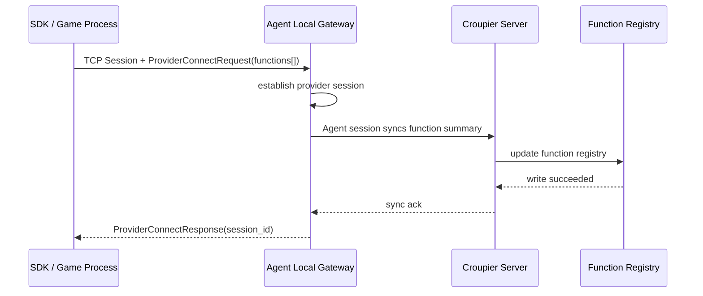
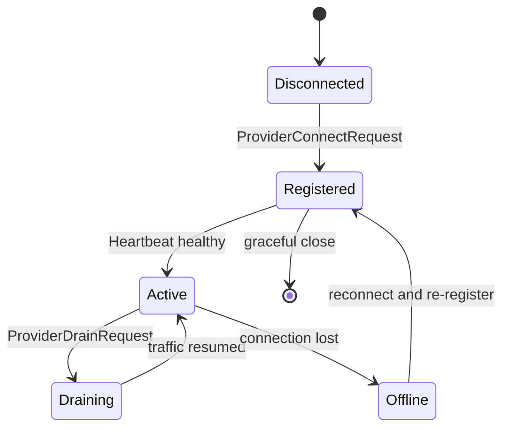

# Function Management

Croupier's core model remains "function-registration driven", but the registration and invocation paths have converged on the unified session design.

## What Is a Function

A function is the smallest executable business unit on the platform, typically containing:

- Unique `id`
- Version `version`
- Resource `resource`
- Business action `operation`
- Risk level `risk`
- Input `inputSchema`
- Output `outputSchema`
- Capability semantics `capability`

## Current Registration Model

The current registration model uses the Provider Session design:

1. The SDK or a local process actively connects to the Agent's local gateway
2. The first frame carries `ProviderConnectRequest`
3. Function descriptors ride in `functions[]`
4. The Agent establishes a provider session
5. The Agent then syncs the summary to the Server through the `agent-server subprotocol`



## Function Descriptor

A function descriptor should express the generic fields the platform cares about; governance fields must not be hidden inside the business payload.

Typical fields:

```json
{
  "id": "player.ban",
  "version": "1.0.0",
  "risk": "high",
  "resource": "player",
  "operation": "ban",
  "capability": "action",
  "tags": ["player", "moderation"],
  "summary": "Ban a player",
  "description": "Ban the given player account",
  "inputSchema": {
    "type": "object",
    "properties": {
      "player_id": { "type": "string" },
      "duration": { "type": "integer" },
      "reason": { "type": "string" }
    },
    "required": ["player_id", "duration"]
  },
  "outputSchema": {
    "type": "object",
    "properties": {
      "success": { "type": "boolean" },
      "ban_id": { "type": "string" }
    }
  }
}
```

**Risk level (`risk`):**

| Level     | Description         | Approval requirement          | Allowed roles  |
| --------- | ------------------- | ----------------------------- | -------------- |
| `safe`    | Safe operation      | No approval                   | user, operator |
| `warning` | Advisory risk       | No approval, audit required   | operator       |
| `high`    | High-risk operation | Single-admin approval + audit | admin          |
| `danger`  | Dangerous operation | Two-person approval + audit   | super_admin    |

> The contract layer uses `safe/warning/high/danger` (Descriptor v2 spec;
> `low/medium` are legacy aliases only, normalized at registration); policy-layer
> config keys (configs/default-policies.yaml) keep the historical
> low/medium/high/danger naming.

Registering a function automatically creates the corresponding default policies for its risk level; they can be overridden through the API. See the [Permissions](./permissions.md) doc for details.

## OpenAPI and JSON Schema

Function descriptors can absorb common OpenAPI fields. OpenAPI here is a function capability contract, not a Dashboard page model:

- Platform protocol layer: protobuf
- Business payload layer: UTF-8 JSON
- Parameter and response contracts: JSON Schema / OpenAPI Schema
- Form presentation candidates: JSON Schema + FormPresentationSpec

This means SDK users do not need to define their own `.proto` before integrating.

The Server generates form presentation candidates for the PageProposal from `inputSchema` or the OpenAPI request schema. The Dashboard form renderer uses JSON Schema validation and FormPresentationSpec, and does not guess page business semantics at runtime.

Full business pages are managed by the Resource Catalog and Page Studio. The Server first normalizes functions into FunctionContract / ResourceCapability / CapabilitySemantics, then generates the PageProposal. PageSpec is the strongly typed page DSL, responsible for page-level capabilities such as pagination, tables, details, modals, task status, and charts, and is rendered by the ProComponents renderer.

See [Function Registration and the Default UI](./function-registration-ui.md) and the [Dashboard Resource/Page Model](../../architecture/dashboard-page-model.md).

## Invocation Model

Once a function is registered, invocations reuse the existing session as well:

- Synchronous invocation
  - `InvokeRequest`
  - `InvokeResponse`
- Async task
  - `StartTaskRequest`
  - `StartTaskResponse`
  - `TaskEvent`
  - `CancelTaskRequest`

Key points:

- The Agent can push requests to the SDK proactively over the same session
- No more dependence on the Agent calling back to an SDK-local address

## Lifecycle



## Design Boundaries

The function management protocol is based on the Provider Session design:

- `ProviderConnectRequest` / `ProviderConnectResponse` - establish a session and register functions
- `ProviderHeartbeatRequest` / `ProviderHeartbeatResponse` - session keepalive
- `ProviderDrainRequest` / `ProviderDrainResponse` - graceful shutdown
- The SDK connects to the Agent proactively, carrying function descriptors in `functions[]`
- The Agent maintains the provider session and syncs function summaries to the Server

## Best Practices

1. Function IDs should be stable and readable, e.g. `player.ban`
2. Fill in `summary`, `description`, `inputSchema`, and `outputSchema`
3. To be auto-included in a CRUD Resource, fill in `resource`, `capability`, `inputSchema`, and `outputSchema`; when the SDK has no REST semantics, the Resource Catalog reviews identity/collection capabilities
4. Dynamic menu localization, page titles, and button copy can only be configured in Page Studio / PageSpec
5. Fields the platform must understand belong in the protocol layer
6. Business-specific parameters go into the JSON payload
7. Handlers should be idempotent and timeout-aware

## Related Docs

- [Core Concepts Overview](./overview.md)
- [Function Registration and the Default UI](./function-registration-ui.md)
- [Dashboard Resource/Page Model](../../architecture/dashboard-page-model.md)
- [SDK Wire Protocol](../../architecture/sdk-wire-protocol.md)
- [SDK docs](../../sdks/)
