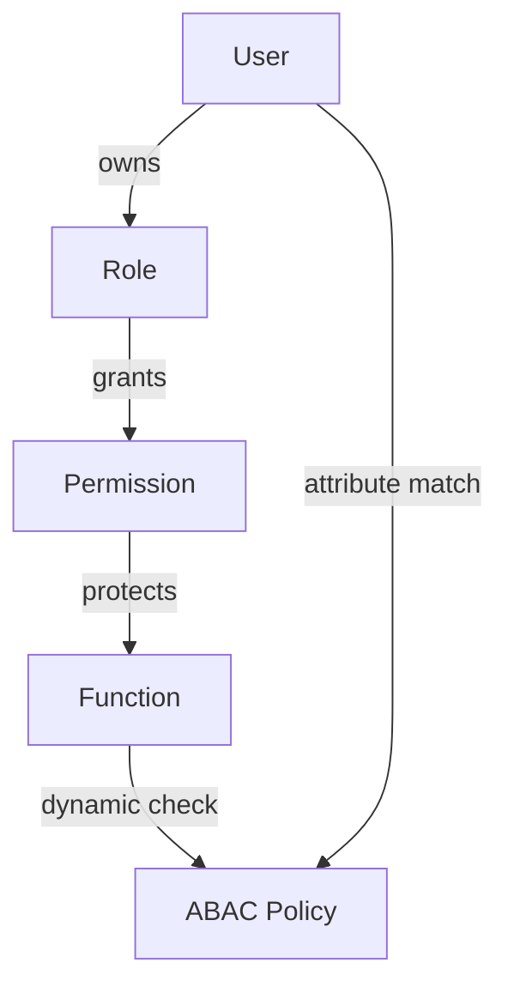
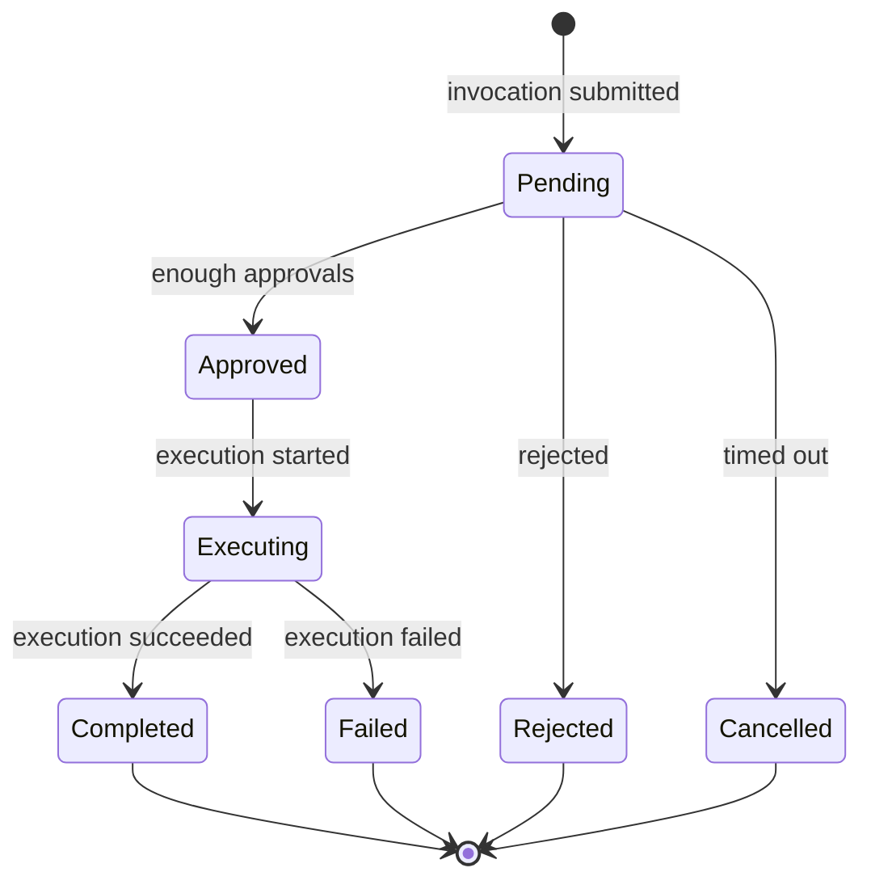

# Permissions

Croupier implements a **zero-trust security** model, providing hybrid RBAC/ABAC access control, operation approval, and a complete audit chain.

## Table of Contents

[[toc]]

## Permission Model

### Overall Architecture



### RBAC Model

RBAC (Role-Based Access Control) is role-based access control.

```
User (User)
  ↓ owns
Role (Role)
  ↓ grants
Permission (Permission)
  ↓ protects
Function (Function)
```

### ABAC Model

ABAC (Attribute-Based Access Control) is attribute-based access control.

```javascript
// evaluation expression
user.roles.includes("admin") || (gameId === "my-game" && env === "dev");
```

## Users and Roles

### User Definition

```json
{
  "user_id": "user_123",
  "username": "admin",
  "email": "admin@example.com",
  "roles": ["admin", "operator"],
  "attributes": {
    "department": "operations",
    "level": 5
  }
}
```

### Role Definition

```json
{
  "role_id": "admin",
  "name": "Administrator",
  "permissions": [
    "*.*"  // all permissions
  ]
}

{
  "role_id": "gm",
  "name": "Game Master",
  "permissions": [
    "player.*",
    "item.*",
    "guild.*"
  ]
}

{
  "role_id": "viewer",
  "name": "Viewer",
  "permissions": [
    "player.view",
    "item.view"
  ]
}
```

## Permission Definitions

### Permission Format

```
{entity}.{operation}

Examples:
- player.ban      # ban a player
- player.view     # view a player
- item.create     # create an item
- item.delete     # delete an item
- *.*             # all permissions (use with care)
```

### Game Scoping

Permissions can be scoped to a specific game:

```
game:{gameId}:{permission}

Examples:
- game:my-game:player.ban    # ban permission for my-game only
- game:test-game:*.*         # all permissions for test-game
```

In actual requests, Croupier also applies environment-level governance with `env`, so the full business boundary is usually `gameId + env` (`game_id` at the proto/DB layer).

## Function Permission Configuration

### Basic Permission

```json
{
  "id": "player.ban",
  "auth": {
    "permission": "player.ban"
  }
}
```

### ABAC Expressions

```json
{
  "id": "player.ban",
  "auth": {
    "permission": "player.ban",
    "allow_if": "has_role('admin') || has_role('senior_gm')"
  }
}
```

### Available Expressions

| Function               | Description        | Example                                 |
| ---------------------- | ------------------ | --------------------------------------- |
| `has_role(role)`       | Check a role       | `has_role('admin')`                     |
| `has_permission(perm)` | Check a permission | `has_permission('player.view')`         |
| `==`                   | Equals             | `env == 'prod'`                         |
| `!=`                   | Not equals         | `env != 'dev'`                          |
| `&&`                   | Logical AND        | `has_role('admin') && env == 'prod'`    |
| `\|\|`                 | Logical OR         | `has_role('admin') \|\| has_role('gm')` |
| `()`                   | Grouping           | `(a \|\| b) && c`                       |

### Available Variables

| Variable     | Type   | Description                            |
| ------------ | ------ | -------------------------------------- |
| `user`       | object | Current user information               |
| `user.roles` | array  | The user's role list                   |
| `gameId`     | string | Target game ID                         |
| `env`        | string | Logical environment (dev/staging/prod) |
| `functionId` | string | The function being invoked             |

## Approval Workflow

### Two-Person Rule

High-risk operations require two-person approval:

```json
{
  "id": "player.ban",
  "auth": {
    "permission": "player.ban",
    "two_person_rule": true,
    "approval": {
      "enabled": true,
      "threshold": 2 // requires two approvers
    }
  }
}
```

### Approval Flow



### Approval API

```bash
# create an approval request
POST /api/approvals
{
  "function_id": "player.ban",
  "payload": {...},
  "reason": "player used cheats"
}

# list pending approvals
GET /api/approvals?state=pending

# approve
POST /api/approvals/{id}/approve

# reject
POST /api/approvals/{id}/reject
{
  "reason": "insufficient evidence"
}
```

## Audit Log

### Audit Events

Every operation is written to the audit log:

```json
{
  "audit_id": "audit_20241201_001",
  "timestamp": "2024-12-01T10:30:00Z",
  "user": {
    "user_id": "user_123",
    "username": "admin"
  },
  "action": "function.invoke",
  "game_id": "my-game",
  "env": "prod",
  "function_id": "player.ban",
  "payload_preview": {
    "player_id": "***",
    "duration": 24
  },
  "result": "success",
  "approval_id": "approval_123",
  "ip": "192.168.1.100",
  "ip_region": "Shanghai, China"
}
```

### Sensitive Field Masking

```yaml
# configure masked fields
server:
  audit:
    sensitive_fields:
      - "password"
      - "token"
      - "secret"
      - "api_key"
```

### Tamper-Proof Audit Chain

Every audit record carries a hash:

```json
{
  "audit_id": "audit_001",
  "hash": "sha256(prev_hash + content)",
  "prev_hash": "sha256(...)"
}
```

## Risk Levels

### Risk Grading

| Level    | Description | Approval requirement  | Audit requirement | Allowed roles  |
| -------- | ----------- | --------------------- | ----------------- | -------------- |
| `low`    | Low risk    | No approval           | No audit          | user, operator |
| `medium` | Medium risk | No approval           | Audit required    | operator       |
| `high`   | High risk   | Single-admin approval | Audit required    | admin          |
| `danger` | Dangerous   | Two-person approval   | Audit required    | super_admin    |

### Two-Layer Policy Architecture

Croupier uses a **two-layer policy architecture**, combining config-file default policies with database override policies:

```
┌─────────────────────────────────────────────────────────────┐
│                    Function invocation request               │
└─────────────────────────────────────────────────────────────┘
                            │
                            ▼
┌─────────────────────────────────────────────────────────────┐
│  1. Check the database override policy (FunctionPolicy)      │
│     ├─ Override exists? use the override policy              │
│     └─ No override? use the default risk-level policy        │
└─────────────────────────────────────────────────────────────┘
                            │
                            ▼
┌─────────────────────────────────────────────────────────────┐
│  2. Apply policy checks                                      │
│     ├─ Role permission check (AllowedRoles)                  │
│     ├─ Approval requirement check (RequireApproval)          │
│     └─ Audit requirement check (RequireAudit)                │
└─────────────────────────────────────────────────────────────┘
                            │
                            ▼
┌─────────────────────────────────────────────────────────────┐
│  3. Execute follow-up actions                                │
│     ├─ Approval needed? create an approval request           │
│     ├─ Audit needed? write the audit log                     │
│     └─ All conditions met? execute the function invocation   │
└─────────────────────────────────────────────────────────────┘
```

**Policy sources:**

| Source    | Description                                           | Priority | How to change        |
| --------- | ----------------------------------------------------- | -------- | -------------------- |
| `default` | Default policies from `configs/default-policies.yaml` | Low      | Edit the config file |
| `manual`  | Override policies in the database                     | High     | Set/delete via API   |

**Default policy configuration** (`configs/default-policies.yaml`):

```yaml
low:
  require_approval: false
  require_audit: false
  allowed_roles: [user, operator]

medium:
  require_approval: false
  require_audit: true
  allowed_roles: [operator]

high:
  require_approval: true
  approval_workflow: single_admin
  require_audit: true
  allowed_roles: [admin]

danger:
  require_approval: true
  approval_workflow: two_person
  require_audit: true
  allowed_roles: [super_admin]
```

### Risk Configuration

```json
{
  "id": "player.ban",
  "ui": {
    "risk_level": "high",
    "risk_warning": "High-risk operation: the player cannot log in after being banned",
    "confirm_message": "Ban this player?"
  }
}
```

### Policy Management API

```bash
# get a function's effective policy
GET /api/v1/functions/:function_id/policy?risk_level=high

# set a function's override policy
PUT /api/v1/functions/:function_id/policy
{
  "require_approval": true,
  "approval_workflow": "single_admin",
  "require_audit": true,
  "allowed_roles": ["admin"]
}

# delete a function's override policy (back to default)
DELETE /api/v1/functions/:function_id/policy

# list all override policies
GET /api/v1/policies/overrides

# get the default policy configuration
GET /api/v1/policies/defaults

# reload the default policy configuration
POST /api/v1/policies/reload
```

### Automatic Policy Creation

At function registration, the system automatically creates default policies based on the function's risk level:

```
Function registration → read the risk_level field → create the FunctionPolicy record
```

If a function specifies no risk level, `medium` is used by default.

## Rate Limiting

### Function-Level Rate Limiting

```json
{
  "id": "player.ban",
  "semantics": {
    "rate_limit": "10rps",
    "concurrency": 5
  }
}
```

### User-Level Rate Limiting

```json
{
  "semantics": {
    "user_rate_limit": "5rps",
    "user_burst": 10
  }
}
```

## Best Practices

### 1. Least Privilege

```json
// ❌ not recommended: over-granting
{
  "roles": ["admin"]  // all permissions
}

// ✅ recommended: grant by need
{
  "roles": ["gm"],  // game-management permissions only
  "permissions": ["player.ban", "player.view"]
}
```

### 2. Environment Isolation

```json
{
  "auth": {
    "allow_if": "env == 'dev' || has_role('admin')"
  }
}
```

### 3. Approval Configuration

```json
{
  "auth": {
    "approval": {
      "enabled": true,
      "threshold": "has_role('admin') ? 1 : 2",
      "approvers": ["admin", "senior_gm"],
      "timeout": "24h"
    }
  }
}
```

### 4. Audit Retention

```yaml
server:
  audit:
    enabled: true
    retention_days: 365
    backup_enabled: true
```

## Related Docs

- [Function Management](./function-management.md)
- [Security Configuration](../../operations/security.md)
