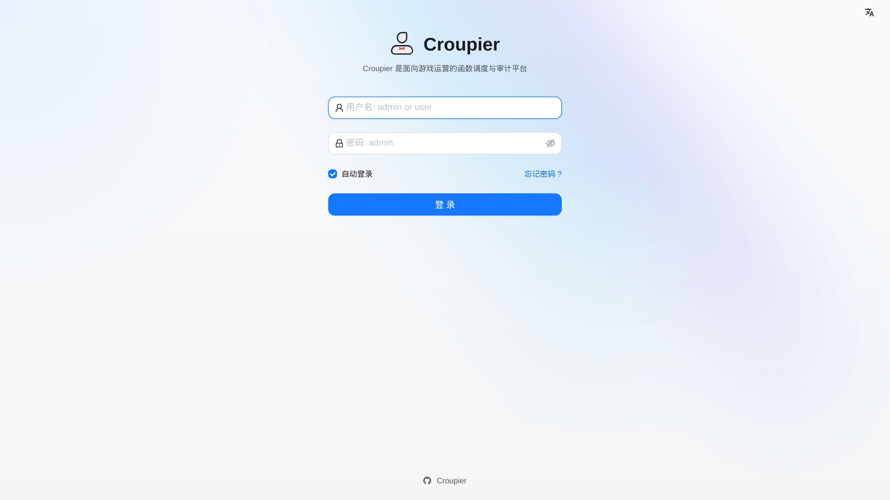
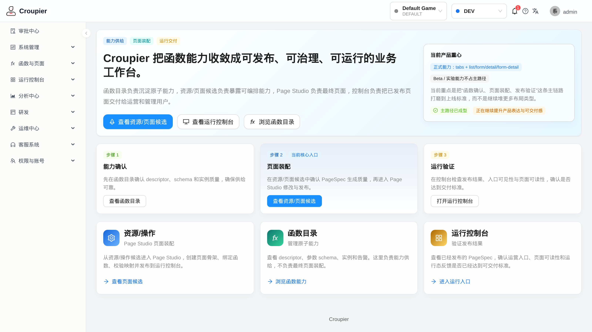
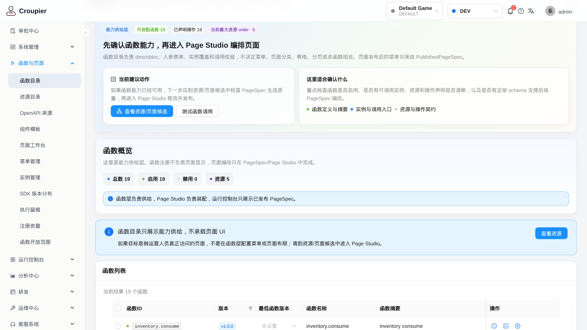
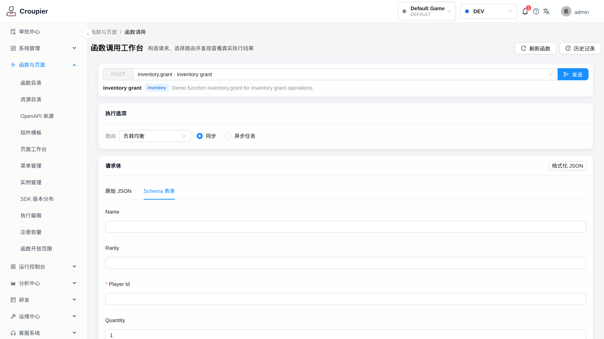
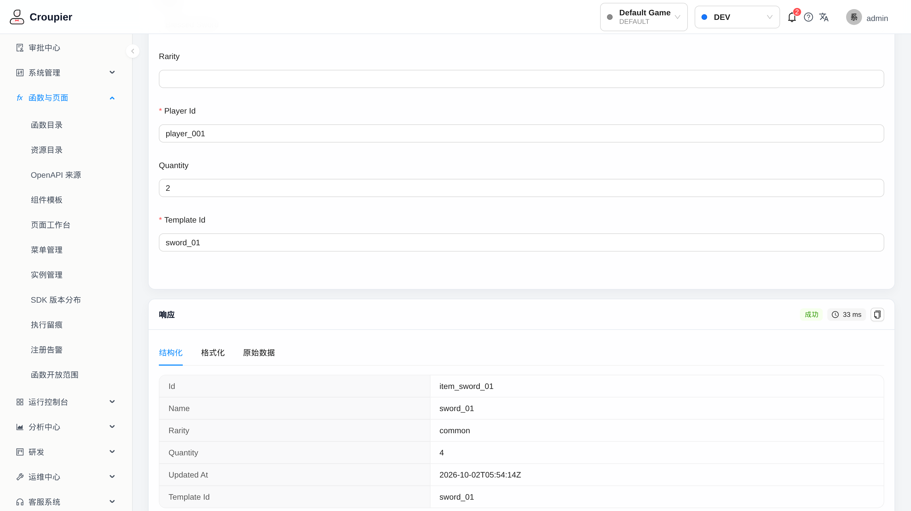
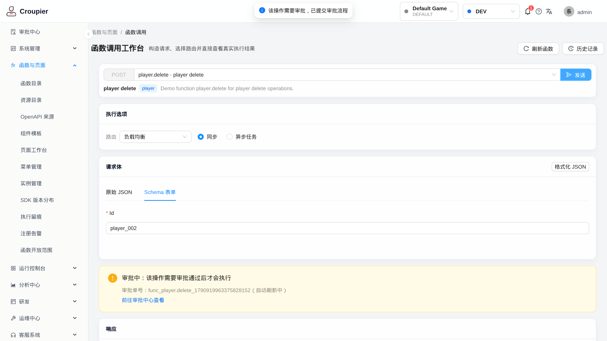
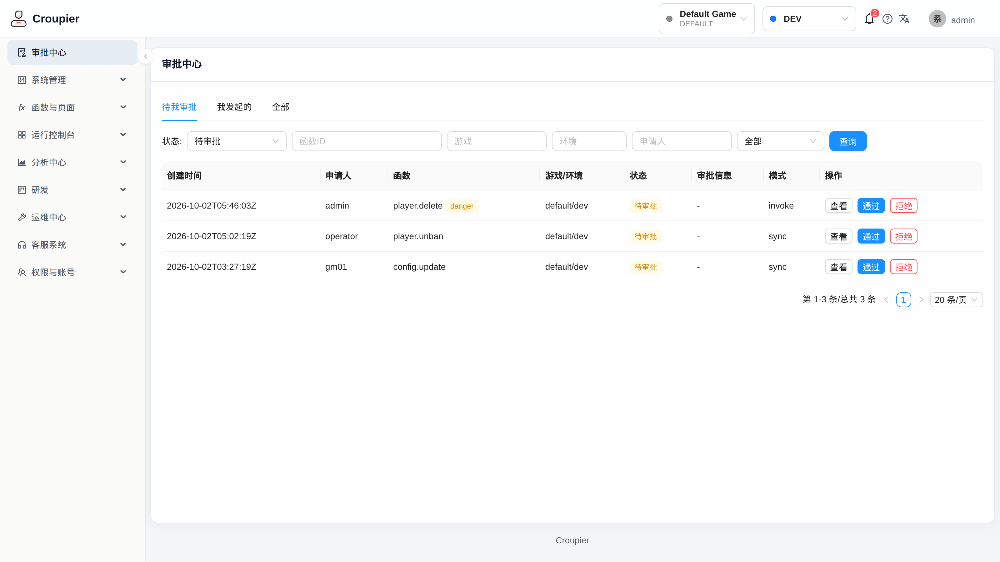
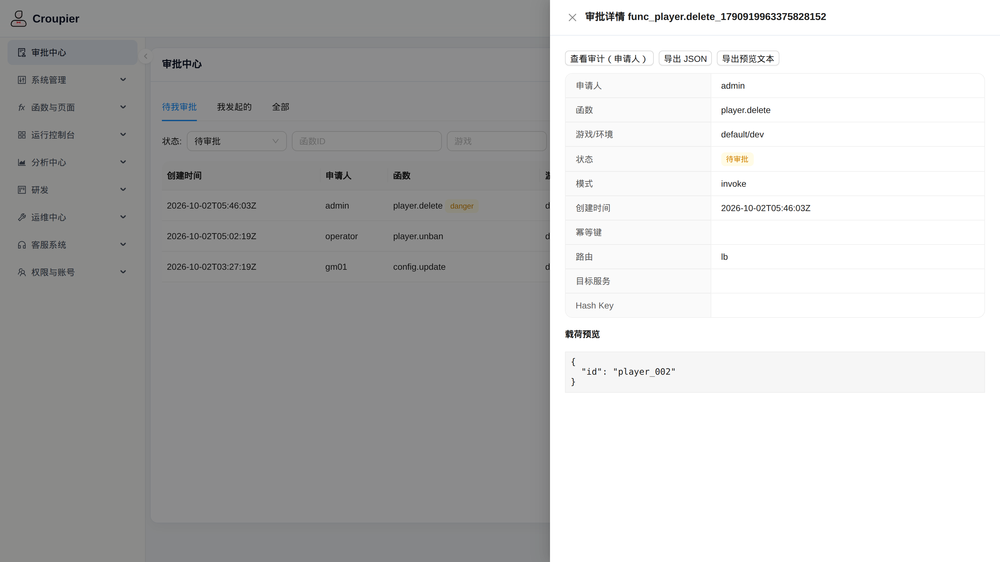
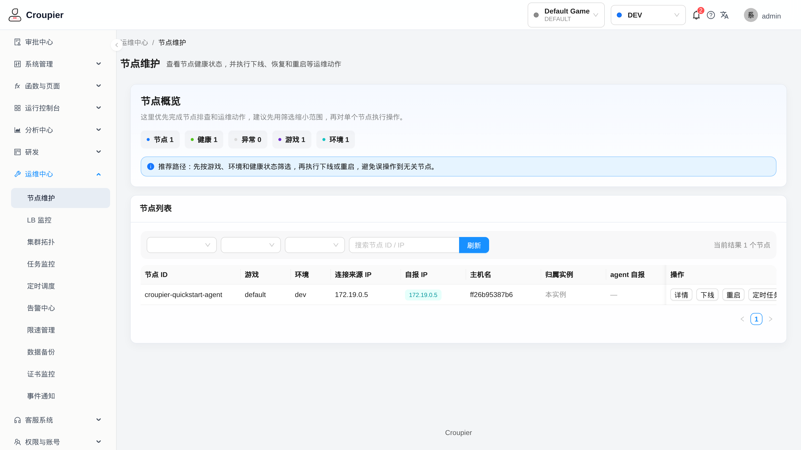
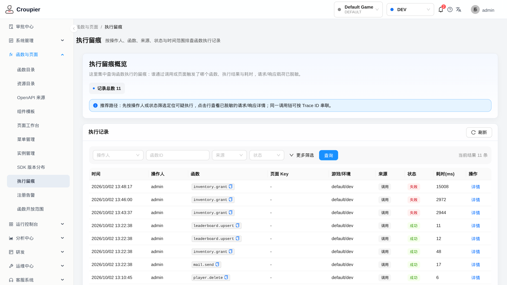

# Interface Preview

All screenshots below come from a **real, running Croupier stack** (the docker compose quick-start stack, see Quick Start) — not mockups or design drafts.

Screenshot environment:

- Game/environment: `default` / `dev`, with 19 functions registered by the SDK example demo service
- Data is demo data; some entries in the approval list come from the product's built-in demo approval seeds (auto-seeded in dev mode, in-memory only, rebuilt on restart)
- Theme: **production builds are pinned to the light theme** (the dark-theme switch drawer is only available in dev mode; the online form is exactly what the screenshots show)

## Login

The unified login entry. Where the admin account comes from is covered in Installation (the bootstrap account in the first-start log; `admin` for the quickstart demo stack).

## Console home

The workbench home after login: the left side shows the permission-trimmed function navigation, and the home page summarizes entry states across the three pipelines — capability supply, page assembly and run delivery. The top-right global game/environment switcher links all page data to the scope.

## Function catalog (capability supply layer)

The function catalog is the capability supply layer: it shows registered functions' descriptors, enable state, instance overrides and invocation entries, and hosts no page UI — operator-facing pages are assembled and published in Page Studio based on PageSpecs. The screenshot shows 19 functions and 5 resources registered by the example demo.

## Function invocation

The schema form is generated automatically from the function descriptor's `inputSchema`, with required-field validation and enum constraints — no hand-written UI per function:

Submitting returns a structured result immediately (formatted / raw JSON views toggleable), with routing and latency info attached:

## High-risk operation approval flow

A high-risk function with an approval policy declared (in the screenshot, `player.delete`, danger level) does **not** execute directly after submission — the caller receives a ticket number and the operation enters the approval center for two-person review:

The approval center has tabs for "Awaiting my approval / Approved by me / All", with risk marks and sources (invoke call / page trigger) on high-risk items:

The approval detail shows the requester, target function, game/environment, routing mode and a masked payload preview, and supports approve / reject with the audit chain recording it:

## Operations · node maintenance

The operations center provides agent node health state, registered function counts, connection info, and offline/restart actions, filtered by scope across multiple games and environments:

## Execution logs

Every function invocation (from the console, a page, or the SDK/API alike) lands in the execution logs: operator, function, source, state and latency; request/response payloads are masked, and a Trace ID links one invocation chain together:

