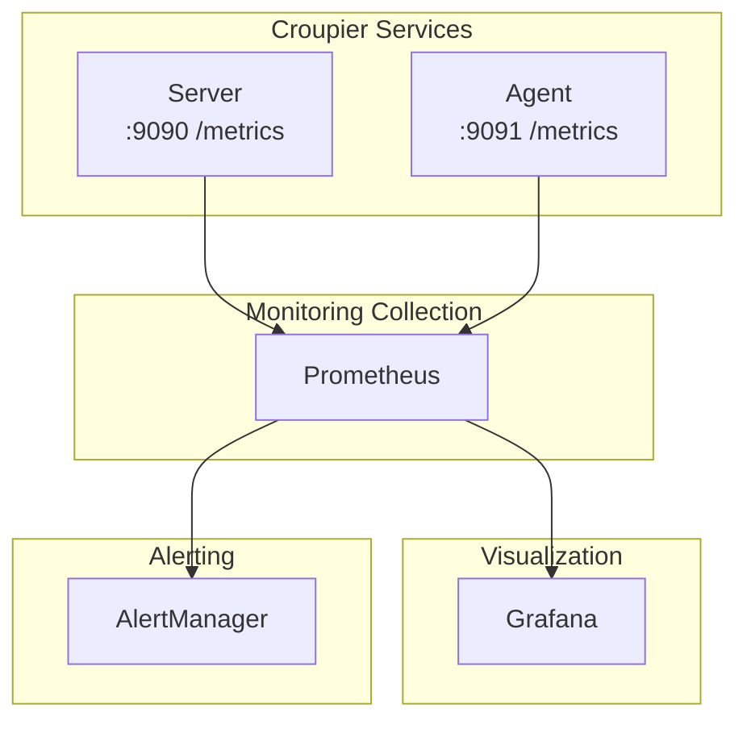

# Monitoring Guide

This document describes Croupier's monitoring, logging, and alerting configuration.

## Table of Contents

[[toc]]

## Monitoring Architecture



## Prometheus Metrics

The Server exposes a Prometheus exposition endpoint, **disabled by default**. Once enabled, Prometheus can scrape it directly without deploying an OTel Collector (no interference with the OTLP push pipeline):

```yaml
telemetry:
  prometheus:
    enabled: true
    path: /metrics/prometheus # default value, customizable
```

The endpoint is unauthenticated (scrapers carry no JWT), and the path is automatically added to the auth whitelist when enabled.

### Server Metrics

| Metric name                     | Type  | Description                               |
| ------------------------------- | ----- | ----------------------------------------- |
| `croupier_db_up`                | Gauge | Database connectivity (1=ok 0=fault)      |
| `croupier_db_latency_ms`        | Gauge | Database ping latency (ms)                |
| `croupier_agents_total`         | Gauge | Number of registered Agents               |
| `croupier_agents_healthy`       | Gauge | Number of Agents passing the health check |
| `croupier_functions_registered` | Gauge | Number of currently registered functions  |
| `go_*` / `process_*`            | -     | Standard Go runtime and process metrics   |

The platform metrics above share the same source and semantics as the JSON endpoint `GET /api/v1/monitoring/metrics` (computed in real time on request, no background sampling).

> Historical documentation once listed metrics such as `croupier_server_requests_total` that never had a corresponding implementation; they have been removed.

### Agent Metrics

| Metric name                           | Type      | Description                    |
| ------------------------------------- | --------- | ------------------------------ |
| `croupier_agent_connected`            | Gauge     | Agent connection status        |
| `croupier_agent_functions_registered` | Gauge     | Number of registered functions |
| `croupier_agent_jobs_executed_total`  | Counter   | Total jobs executed            |
| `croupier_agent_jobs_duration`        | Histogram | Job execution duration         |

### Configuring Metric Collection

```yaml
# prometheus.yml
scrape_configs:
  - job_name: "croupier-server"
    static_configs:
      - targets: ["server1:9090", "server2:9090", "server3:9090"]

  - job_name: "croupier-agent"
    static_configs:
      - targets: ["agent1:9091", "agent2:9091", "agent3:9091"]
```

## Grafana Dashboards

### Server Dashboard

Import the JSON configuration to create the dashboard:

```json
{
  "dashboard": {
    "title": "Croupier Server",
    "panels": [
      {
        "title": "Request Rate",
        "targets": [
          {
            "expr": "rate(croupier_server_requests_total[5m])"
          }
        ]
      },
      {
        "title": "Request Latency (P99)",
        "targets": [
          {
            "expr": "histogram_quantile(0.99, rate(croupier_server_request_duration_bucket[5m]))"
          }
        ]
      },
      {
        "title": "Function Calls Top 10",
        "targets": [
          {
            "expr": "topk(10, sum by (function_id) (croupier_server_functions_invoked_total))"
          }
        ]
      }
    ]
  }
}
```

## Logging Configuration

### Log Format

Croupier uses structured JSON logs:

```json
{
  "timestamp": "2024-12-01T10:30:00Z",
  "level": "info",
  "component": "server",
  "msg": "Function invoked",
  "game_id": "my-game",
  "env": "prod",
  "function_id": "player.ban",
  "user_id": "user_123",
  "duration_ms": 123
}
```

### Log Configuration

```yaml
server:
  log:
    level: info # debug | info | warn | error
    format: json # console | json
    file: logs/server.log
    max_size: 100 # MB
    max_backups: 3
    max_age: 7 # days
```

### Log Collection (Loki)

```yaml
# promtail-config.yml
server:
  http_listen_port: 9080

positions:
  filename: /tmp/positions.yaml

clients:
  - url: http://loki:3100/loki/api/v1/push

scrape_configs:
  - job_name: croupier
    static_configs:
      - targets:
          - localhost
        labels:
          job: croupier-server
          __path__: /var/log/croupier/*.log
```

## Alerting Rules

### Prometheus Alert Rules

```yaml
# alerts.yml
groups:
  - name: croupier
    interval: 30s
    rules:
      # Service availability
      - alert: CroupierServerDown
        expr: up{job="croupier-server"} == 0
        for: 1m
        labels:
          severity: critical
        annotations:
          summary: "Croupier Server down"
          description: "{{ $labels.instance }} has been down for over 1 minute"

      # Agent offline
      - alert: CroupierAgentDisconnected
        expr: croupier_agent_connected == 0
        for: 5m
        labels:
          severity: warning
        annotations:
          summary: "Croupier Agent offline"
          description: "{{ $labels.instance }} has been offline for over 5 minutes"

      # High error rate
      - alert: HighErrorRate
        expr: |
          rate(croupier_server_requests_total{status="error"}[5m])
          /
          rate(croupier_server_requests_total[5m]) > 0.05
        for: 5m
        labels:
          severity: warning
        annotations:
          summary: "Error rate too high"
          description: "Error rate exceeds 5%"

      # High latency
      - alert: HighLatency
        expr: |
          histogram_quantile(0.99,
            rate(croupier_server_request_duration_bucket[5m])
          ) > 1
        for: 5m
        labels:
          severity: warning
        annotations:
          summary: "Request latency too high"
          description: "P99 latency exceeds 1 second"

      # Approval backlog
      - alert: ApprovalBacklog
        expr: croupier_server_approvals_pending > 50
        for: 1h
        labels:
          severity: warning
        annotations:
          summary: "Approval backlog"
          description: "Pending approvals exceed 50"
```

### AlertManager Configuration

```yaml
# alertmanager.yml
global:
  resolve_timeout: 5m

route:
  group_by: ["alertname", "cluster", "service"]
  group_wait: 10s
  group_interval: 10s
  repeat_interval: 12h
  receiver: "default"

  routes:
    - match:
        severity: critical
      receiver: "pagerduty"

    - match:
        severity: warning
      receiver: "slack"

receivers:
  - name: "default"
    webhook_configs:
      - url: "http://webhook:8080/webhook"

  - name: "pagerduty"
    pagerduty_configs:
      - service_key: "<PAGERDUTY_SERVICE_KEY>"

  - name: "slack"
    slack_configs:
      - api_url: "<SLACK_WEBHOOK_URL>"
        channel: "#alerts"
```

## Distributed Tracing

### OpenTelemetry Integration

```go
import (
    "go.opentelemetry.io/otel"
    "go.opentelemetry.io/otel/exporters/jaeger"
    "go.opentelemetry.io/otel/sdk/trace"
)

func initTracer() error {
    exporter, err := jaeger.New(jaeger.WithCollectorEndpoint(
        jaeger.WithEndpoint("http://jaeger:14268/api/traces"),
    ))
    if err != nil {
        return err
    }

    tp := trace.NewTracerProvider(
        trace.WithBatcher(exporter),
        trace.WithResource(resources.NewWithAttributes(
            semconv.SchemaURL,
            semconv.ServiceName("croupier-server"),
        )),
    )

    otel.SetTracerProvider(tp)
    return nil
}
```

### Tracing Calls

```go
import (
    "go.opentelemetry.io/otel"
)

func (s *Server) InvokeFunction(ctx context.Context, req *Request) (*Response, error) {
    tracer := otel.Tracer("server")
    ctx, span := tracer.Start(ctx, "InvokeFunction")
    defer span.End()

    span.SetAttributes(
        attribute.String("function_id", req.FunctionId),
        attribute.String("game_id", req.GameId),
    )

    // Invoke the Agent
    resp, err := s.agent.InvokeFunction(ctx, req)
    if err != nil {
        span.RecordError(err)
        return nil, err
    }

    return resp, nil
}
```

## Health Checks

### HTTP Health Checks

```bash
# Health check
curl http://localhost:18780/healthz

# Readiness check
curl http://localhost:18780/readyz
```

### Response Example

```json
{
  "status": "ok",
  "checks": {
    "database": "ok",
    "redis": "ok",
    "agents": {
      "total": 5,
      "online": 5
    }
  }
}
```

## Performance Monitoring

### Database Performance

```sql
-- Slow queries
SELECT query, mean_exec_time, calls
FROM pg_stat_statements
WHERE mean_exec_time > 100
ORDER BY mean_exec_time DESC
LIMIT 10;

-- Connection count
SELECT count(*) FROM pg_stat_activity;
```

### Redis Performance

```bash
# Redis info
redis-cli INFO stats

# Slow log
redis-cli SLOWLOG GET 10
```

## Best Practices

### 1. Metric Naming Conventions

```
croupier_<component>_<metric>_<unit>

Examples:
- croupier_server_requests_total
- croupier_agent_functions_registered
- croupier_job_duration_seconds
```

### 2. Label Usage

```go
// Add labels
counter.WithLabelValues(
    "player.ban",  // function_id
    "my-game",     // game_id
    "prod",        // env
    "success",     // status
).Inc()
```

### 3. Log Levels

| Level   | Purpose                    |
| ------- | -------------------------- |
| `debug` | Development debugging info |
| `info`  | Normal operation logs      |
| `warn`  | Warning messages           |
| `error` | Error messages             |

### 4. Sensitive-Data Masking

```yaml
server:
  audit:
    sensitive_fields:
      - "password"
      - "token"
      - "secret"
```

## Probe System, Sampling Policy, and Online Health (Design finalized 2026-10-14, R2/R3 shipped)

> **Status notes**: R2 (agent assembly surface) and R3 (server consumption surface, six sub-batches) were delivered on 2026-10-14 (evidence in the review profile §12); all of the following capabilities are in the code. R4 (dbmon convergence onto the shared kernel) and the game-protocol probe adapters (L2 declarative / L3 per-game) have not landed yet. **The online-trend column is still grayed out as "not connected to online data"** — the SDK metric reporting entry point is unscheduled, and the panel only presents liveness facts.

- **Three-layer probe system**: shared kernel (`core/healthprobe`) / protocol probes (http/tcp/process/db + game-protocol skeleton) / execution location by perspective — **whoever's perspective matters does the probing** (agents provide the business network perspective; the server keeps its own dependency probes and manual diagnostics; third-party monitoring never requires deploying a new agent just for monitoring).
- **Sampling frequency (settable in the server background; explicit defaults when unset)**: three granularities = base interval (default **30s**, same tier as the configsync polling/metrics reporting period; kernel default fail=3 → worst-case 90s window) / by time of day (denser at peak, sparser at trough) / special time points (one-off/calendar-style, e.g. before an event launch). Configuration lands as a ConfigVersion asset, is distributed via configsync, and takes effect hot (worst case 30s); agents never hard-code the frequency locally.
- **Asymmetric reporting**: normal state = aggregated/sampled (success rate, latency distribution, window duration, probe-point distribution, via the metrics batch surface); abnormal state = itemized, immediate (failure stage, raw error, the last 5 attempts, target/execution location/timestamp, via the event surface) — **throttling never affects the failure path; anomalies always get through**.
- **Game server online health**: online data comes from game-side reporting (the business source of truth), aggregated along the existing ops game/env dimensions (no separate dimension tables); health = status matrix (two liveness states × three online-trend tiers) + anomaly evidence, with the sudden-drop threshold defaulting to 50%/5min (compared against the same-time baseline of the previous 7 days, configurable).
- **Managed-program update fingerprints**: every update records a binary sha256 fingerprint (rollbacks audited too); search the execlog by "target + time + fingerprint" to trace the version — align with the alert timeline when investigating "after which update the alerts started"; for the operations model see [Version Upgrade and Rollback](./upgrade-rollback.md).

**Operations touchpoints**

| Aspect     | Location                                                                             | Description                                                                                                                                        |
| ---------- | ------------------------------------------------------------------------------------ | -------------------------------------------------------------------------------------------------------------------------------------------------- |
| Declare    | agent config `probe.targets[]` / server config `probe.targets[]`                     | Only declare what to probe; thresholds/semantics/intervals have explicit defaults, see [Agent Configuration Complete Reference](./config-agent.md) |
| Distribute | Sampling policy `/api/v1/ops/probe/policy` (same capability as the Ops Center panel) | ConfigVersion asset surface; after publishing, agents take effect hot within 30s (version comparison avoids wasted polls)                          |
| Observe    | Node maintenance page "Probe Summary" `GET /api/v1/ops/probe/summary`                | Status matrix (target × execution location), abnormal rows first; no single composite score is produced                                            |
| Alert      | Alert Center (`alertID=probe:<agentId>:<target>`)                                    | Window opens = firing, closes = resolved; failure details are persisted with the window                                                            |
| Rules      | Alert rule metrics `probe.<target>.<successRate/failed/checked/latencyP95Ms>`        | Runs directly on the existing AlertRule evaluator; no new alerting pipeline needed                                                                 |
| Diagnose   | `POST /api/v1/ops/probe/diagnose`                                                    | Probes a local server target once immediately, sharing the same state machine as periodic probing                                                  |

For endpoint and payload details, see API Documentation probe endpoints.

## Related Documentation

- [Troubleshooting](./troubleshooting.md)
