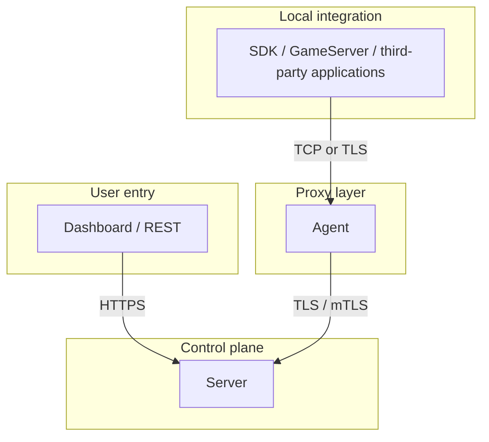

# Security Configuration

This document describes the security boundaries and recommended configuration under the current session architecture.

## Security Boundaries



## Default Policies

### `Agent <-> Server`

- TLS enabled by default
- mTLS recommended in production
- `19090` should be treated as an internal control-plane port

### `SDK <-> Agent`

- TLS may stay off by default
- Enable TLS across hosts, network segments, or in zero-trust environments
- Whether TLS is enabled depends on the deployment boundary, not on a protocol requirement

## Configuration Examples

### Server

`configs/server.yaml`:

```yaml
control:
  addr: ":19090"
  cert: "/etc/croupier/server.crt"
  key: "/etc/croupier/server.key"
  ca: "/etc/croupier/ca.crt"
```

### Agent upstream to the Server

`configs/agent.yaml`:

```yaml
server:
  addr: "server.example.com:19090"
  insecure: false
  serverName: "server.example.com"
  insecureSkipVerify: false
  tlsCertFile: "/etc/croupier/agent.crt"
  tlsKeyFile: "/etc/croupier/agent.key"
  caFile: "/etc/croupier/ca.crt"
```

### Agent local gateway TLS

`configs/agent.yaml`:

```yaml
tls:
  enabled: true
  certFile: "/etc/croupier/agent-local.crt"
  keyFile: "/etc/croupier/agent-local.key"
  caFile: "/etc/croupier/ca.crt"
  insecureSkipVerify: false
```

## Certificate Recommendations

- One internal CA per control domain
- Mutual certificate verification recommended for `Agent <-> Server`
- For `SDK <-> Agent` with TLS enabled, whether client certificates are required is up to the deployment

## Firewall Recommendations

At minimum, make the following port boundaries explicit:

```bash
# REST / Dashboard
ufw allow 18780/tcp

# Agent -> Server session/control
ufw allow 19090/tcp

# SDK / GameServer -> Agent local gateway
ufw allow 19091/tcp
```

If your deployment still keeps legacy compatibility ports, manage them as transitional assets and do not write them into the new baseline.

## Authentication and Authorization

Beyond TLS, keep the following in place:

- JWT / OIDC authentication
- RBAC / ABAC authorization
- Audit logs
- High-risk operation approval

TLS only answers "who is talking to whom"; it does not replace platform-level access control.

## External Identity Sources (LDAP / OIDC)

By default the platform uses only local accounts (`admins` table + bcrypt + TOTP). With an enterprise identity source, enable providers under `auth.providers` as needed; everything is off by default:

```yaml
auth:
  providers:
    ldap:
      enabled: true
      addr: "ldap://ldap.example.com:389"
      baseDn: "dc=example,dc=com"
      bindDn: "uid=svc-croupier,ou=system,dc=example,dc=com"
      bindPassword: "${LDAP_BIND_PASSWORD}"
      userFilter: "(uid=%s)"
      startTls: true
      defaultRoles: ["viewer"]
    oidc:
      enabled: true
      issuer: "https://keycloak.example.com/realms/main"
      clientId: "croupier"
      clientSecret: "${OIDC_CLIENT_SECRET}"
      redirectUrl: "https://croupier.example.com/api/auth/oidc/callback"
      defaultRoles: ["viewer"]
      loginSuccessUrl: "https://croupier.example.com/login"
```

See `configs/auth-providers.example.yaml` for the full field reference. Behavioral conventions:

- **Login cascade**: password login tries in `local → ldap` order; when the local attempt fails and LDAP is enabled, it falls back to LDAP automatically — the login form needs no distinction.
- **JIT account creation**: an external identity's first login automatically creates a local shadow account (random password, cannot log in locally) and grants local roles per `defaultRoles`; roles and permissions are always decided by local RBAC — external identities only answer "who you are".
- **OIDC flow**: the login page fetches enabled methods via `GET /api/v1/auth/providers`; `GET /api/v1/auth/oidc/login` redirects to the identity source, and the callback `GET /api/v1/auth/oidc/callback` exchanges for the identity and issues the platform JWT (the same token system as password login; subsequent requests are identical).
- **Degradation on failure**: if the OIDC identity source is unreachable at Server startup, only OIDC login is disabled (with a warning log); local and LDAP login are unaffected. LDAP dials at authentication time, so a directory failure shows up as "authentication service temporarily unavailable".
- **Audit**: login audit records carry a `provider` field distinguishing `local` / `ldap` / `oidc` origins.

## Login Methods and Self-Service Registration (L3 runtime keys)

Beyond static yaml declarations, login methods and registration policy support database L3 runtime keys (Settings Center "Account security" tab; saving hot-reloads the identity sources, `auth.*` key family):

- **Password login switch** `auth.local.enabled` (default on; turning it off has an anti-lockout guard — it is refused if the local admin accounts could not log in through any other identity source).
- **OAuth identity sources** `auth.providers.github.*` / `wechat.*` / `generic.*` (custom OAuth2 endpoints): the same `auth.providers` model as the yaml-declared LDAP/OIDC; L3 overrides yaml and takes effect hot.
- **Self-service registration** `auth.register.enabled` (default off; anonymous `POST /api/v1/auth/register` returns 403 `registration_disabled` when off) + `auth.register.defaultRoles` (empty = no roles granted).
- **Email policy** `auth.email.domainWhitelist` (empty = unrestricted) / `auth.email.aliasRestriction` (rejection + dot-stripping normalization for dedup) / `auth.email.verificationRequired` (registration requires email verification, completed via `GET /api/v1/auth/verify-email`).

## Outbound Security and Restrictions (sec.*)

Server-side outbound HTTP (the notification webhooks and the "check for updates" call) is constrained by the outbound guard (`sec.*` key family, Settings Center "Account security → Outbound security and restrictions" card; hot-effective on save):

- `sec.allowPorts`: port whitelist (empty = unrestricted); `sec.domainFilter`: domain-suffix whitelist (once set, only listed domains may go outbound); `sec.allowIPs`: single-IP/CIDR allowlist.
- `sec.ssrfProtection`: when on, both DNS resolution and the real connection intercept private/loopback/link-local addresses (the peer IP is re-checked before dialing, eliminating resolution rebinding).

Boundary: the guard only covers outbound calls whose URLs users can configure — agent/database/SDK channels and fixed-URL calls (GitHub OAuth etc.) bypass it; everything is off by default with zero behavior change. Query effective values at `GET /api/v1/site/outbound`.

## High-Risk Approval Step-Up Verification (TOTP)

Approvals of governance risk high / danger (the two forced-approval tiers in the default policies) require step-up verification before the approval action is persisted (OPEN-ISSUES #75):

- Accounts with TOTP bound: `POST /api/v1/approvals/:id/approve` must carry `otp`; wrong codes are rejected (`otp_invalid`).
- Unenrolled accounts: rejected outright (`otp_not_enrolled`), with a hint to bind TOTP in the web "Profile - Security settings" — silent passes are forbidden for high-risk approvals.
- Medium/low risk: `otp` is optional; if provided it is validated, and wrong codes are rejected.

**Master switch** `security.approvalStepUpOtp` (OPEN-ISSUES #61, Settings page "System settings - Site settings - Security"): default on (fail-safe — the forced semantics hold when settings are uninitialized or the key is unset). When off, high-risk approval degrades to optional verification (still validated when provided), and the approval audit `stepUp` tier records `disabled` — so which high-risk operations the switch let through stays auditable after the fact. The mobile client is positioned as a convenience; when the enforced gate misbehaves, the server downgrades it in one click instead of rolling back a release.

The full contract of stable error codes and audit tiers is in `docs/api/approval.md`; the otp value is never written to audits/logs.

## Best Practices

1. Enable mTLS by default for production `Agent <-> Server`
2. Decide TLS for `SDK <-> Agent` based on the network boundary
3. Never take `insecureSkipVerify` into production
4. Manage certificates, the JWT secret, and database credentials in a Secret Manager
5. Keep audit logs and sensitive-field masking permanently on

## Legacy Models Explicitly No Longer Recommended

- Describing the internal control link as `gRPC`
- Writing `19090` with the fixed semantics of "the control link"
- Having the SDK open a local port for the Agent to call back
- Using `rpc_addr` as a long-term runtime dependency

## Database Backup and Restore

### Backup (automated)

`POST /api/v1/backups` creates the backup record and then **actually executes** the export (asynchronously):

1. Pick the tool by the current `database.driver`: mysql → `mysqldump`, postgres → `pg_dump`, sqlite → file copy
2. Export to a temp file → compute sha256 → upload to object storage (`storage.*` config; the file driver is the local `backups/` directory)
3. Update the record to `succeeded` (with location/size/checksum) or `failed` (with the error)

Requirements: `mysqldump`/`pg_dump` must be installed in the Server's runtime environment (container images can add `default-mysql-client`/`postgresql-client`). Passwords are passed via the `MYSQL_PWD`/`PGPASSWORD` environment variables and never appear on the command line or in process lists.

A scheduled task (`/api/v1/schedules`) should trigger daily backups, and high-value backups should have their `location` archived to external storage.

### Restore (runbook)

```bash
# 1. Fetch the backup file from object storage / the local directory
ls data/uploads/backups/           # file driver
# or download from S3/OSS/COS by the location recorded in the record

# 2. Verify integrity (compare against the record's checksum)
sha256sum <backup-file>

# 3. Restore (run against the target database; rehearse on a shadow DB before a production restore)
mysql -h <host> -u <user> -p <db> < backup.sql          # mysql
psql -h <host> -U <user> -d <db> -f backup.sql          # postgres
# sqlite: stop the server and replace the file
cp <backup-file> /path/to/croupier.db

# 4. Restart the Server and spot-check key tables (admins/audit_records/task_runs row counts and timestamps)
```

Note: restore is a high-risk operation — it must go through two-person-rule approval and keep a full operation record.
