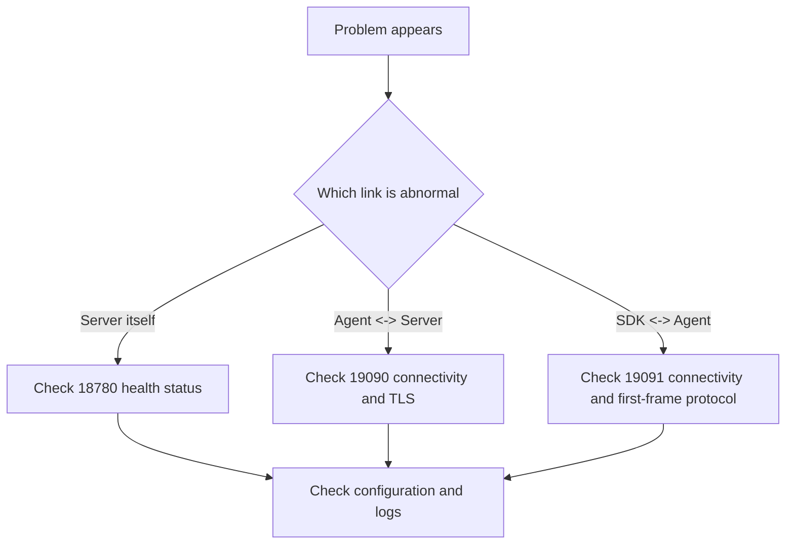

# Troubleshooting Guide

This document focuses on the most common troubleshooting paths under the current session architecture.

## Key Ports

- `18780`: Server REST API
- `19090`: Server session/control entry point
- `19091`: Agent local gateway

## Quick Diagnosis



## Server Fails to Start

### Check the Configuration

```bash
python3 -c "import yaml; yaml.safe_load(open('configs/server.yaml'))"
```

### Check the Ports

```bash
lsof -i :18780
lsof -i :19090
```

### Check the Health Status

```bash
curl http://localhost:18780/healthz
```

## Agent Cannot Connect to the Server

### Check Whether the Server Is Online

```bash
curl http://server:18780/healthz
nc -zv server 19090
```

### Check TLS

```bash
openssl s_client -connect server:19090 \
  -cert agent.crt \
  -key agent.key \
  -CAfile ca.crt
```

### Common Causes

| Symptom               | Cause                                                                   |
| --------------------- | ----------------------------------------------------------------------- |
| `connection refused`  | The Server session/control port is not listening                        |
| TLS handshake failure | Wrong certificate, CA, SNI, or mTLS configuration                       |
| Repeated reconnecting | Wrong target address, first-frame validation failure, heartbeat timeout |

## SDK Cannot Connect to the Agent

### Check the Local Gateway

```bash
nc -zv 127.0.0.1 19091
```

### Key Checks

- The SDK connects to `19091`, not `19090`
- The SDK's first frame must be a `ProviderConnectRequest`
- The SDK should not require a locally listening port
- The SDK should not configure `rpc_addr`

### Common Causes

| Symptom                               | Cause                                                                         |
| ------------------------------------- | ----------------------------------------------------------------------------- |
| Disconnects immediately after connect | The first frame is not a `ProviderConnectRequest` or the body fails to decode |
| Cannot reach the Agent                | Connected to the wrong port, the Agent is not started, or TLS mismatch        |
| No recovery after disconnect          | Reconnect policy not enabled or backoff misconfigured                         |

## Call Failures

### Check Whether the Function Is Registered

```bash
curl http://localhost:18780/api/v1/functions
curl http://localhost:18780/api/v1/functions/descriptors
```

### Check Call Timeouts

Investigate in order:

- Whether the SDK handler is blocking
- Whether `requestTimeoutMs` is too short
- Whether the session is in the draining state
- Whether the Agent / Server is applying backpressure

## Common TLS Issues

### Untrusted Certificate

```text
x509: certificate signed by unknown authority
```

Checks:

- Whether `caFile` points to the correct CA
- Whether the client and server use the same trust chain

### Hostname Mismatch

```text
x509: certificate is not valid for any names
```

Checks:

- Whether `serverName` matches the certificate SAN / CN
- Whether an IP address was mistakenly used as the certificate name

## Legacy Concept Check

If you see the following concepts in logs, configuration, or documentation, first suspect you have hit a legacy path:

- `gRPC`
- `legacy REQ/REP`
- `LocalControlService`
- `RegisterLocal`
- `rpc_addr`
- SDK local listening

None of these concepts should any longer serve as the baseline for new troubleshooting.
