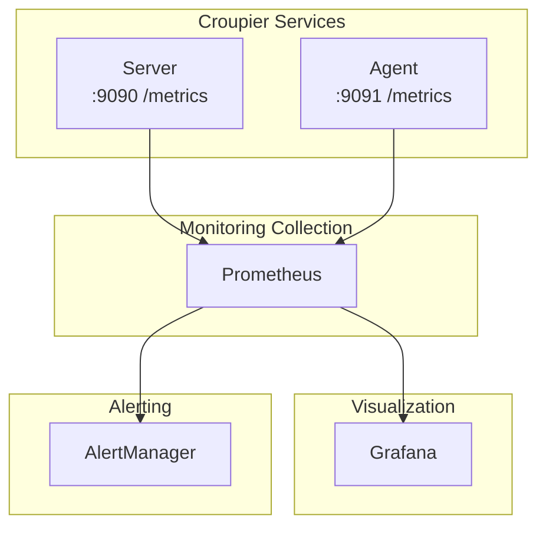

# 监控指南

本文介绍 Croupier 的监控、日志与告警配置。

## 目录

[[toc]]

## 监控架构



## Prometheus 指标

Server 暴露 Prometheus 抓取端点，**默认关闭**。启用后 Prometheus 可直接抓取，无需部署 OTel Collector（与 OTLP push 链路互不干扰）：

```yaml
telemetry:
  prometheus:
    enabled: true
    path: /metrics/prometheus # default value, customizable
```

该端点不做鉴权（抓取方没有 JWT），启用时路径自动加入鉴权白名单。

### Server 指标

| 指标名                          | 类型  | 说明                          |
| ------------------------------- | ----- | ----------------------------- |
| `croupier_db_up`                | Gauge | 数据库连通性（1=正常 0=故障） |
| `croupier_db_latency_ms`        | Gauge | 数据库 ping 时延（ms）        |
| `croupier_agents_total`         | Gauge | 已注册 Agent 数               |
| `croupier_agents_healthy`       | Gauge | 通过健康检查的 Agent 数       |
| `croupier_functions_registered` | Gauge | 当前注册函数数                |
| `go_*` / `process_*`            | -     | 标准 Go runtime 与进程指标    |

以上平台指标与 JSON 端点 `GET /api/v1/monitoring/metrics` 同源同义（请求时实时计算，无后台采样）。

> 历史文档曾列出 `croupier_server_requests_total` 等从未有对应实现的指标，已删除。

### Agent 指标

| 指标名                                | 类型      | 说明           |
| ------------------------------------- | --------- | -------------- |
| `croupier_agent_connected`            | Gauge     | Agent 连接状态 |
| `croupier_agent_functions_registered` | Gauge     | 已注册函数数   |
| `croupier_agent_jobs_executed_total`  | Counter   | 累计执行任务数 |
| `croupier_agent_jobs_duration`        | Histogram | 任务执行时长   |

### 配置抓取

```yaml
# prometheus.yml
scrape_configs:
  - job_name: "croupier-server"
    static_configs:
      - targets: ["server1:9090", "server2:9090", "server3:9090"]

  - job_name: "croupier-agent"
    static_configs:
      - targets: ["agent1:9091", "agent2:9091", "agent3:9091"]
```

## Grafana 面板

### Server 面板

导入 JSON 配置创建面板：

```json
{
  "dashboard": {
    "title": "Croupier Server",
    "panels": [
      {
        "title": "Request Rate",
        "targets": [
          {
            "expr": "rate(croupier_server_requests_total[5m])"
          }
        ]
      },
      {
        "title": "Request Latency (P99)",
        "targets": [
          {
            "expr": "histogram_quantile(0.99, rate(croupier_server_request_duration_bucket[5m]))"
          }
        ]
      },
      {
        "title": "Function Calls Top 10",
        "targets": [
          {
            "expr": "topk(10, sum by (function_id) (croupier_server_functions_invoked_total))"
          }
        ]
      }
    ]
  }
}
```

## 日志配置

### 日志格式

Croupier 使用结构化 JSON 日志：

```json
{
  "timestamp": "2024-12-01T10:30:00Z",
  "level": "info",
  "component": "server",
  "msg": "Function invoked",
  "game_id": "my-game",
  "env": "prod",
  "function_id": "player.ban",
  "user_id": "user_123",
  "duration_ms": 123
}
```

### 日志配置项

```yaml
server:
  log:
    level: info # debug | info | warn | error
    format: json # console | json
    file: logs/server.log
    max_size: 100 # MB
    max_backups: 3
    max_age: 7 # days
```

### 日志采集（Loki）

```yaml
# promtail-config.yml
server:
  http_listen_port: 9080

positions:
  filename: /tmp/positions.yaml

clients:
  - url: http://loki:3100/loki/api/v1/push

scrape_configs:
  - job_name: croupier
    static_configs:
      - targets:
          - localhost
        labels:
          job: croupier-server
          __path__: /var/log/croupier/*.log
```

## 告警规则

### Prometheus 告警规则

```yaml
# alerts.yml
groups:
  - name: croupier
    interval: 30s
    rules:
      # Service availability
      - alert: CroupierServerDown
        expr: up{job="croupier-server"} == 0
        for: 1m
        labels:
          severity: critical
        annotations:
          summary: "Croupier Server down"
          description: "{{ $labels.instance }} has been down for over 1 minute"

      # Agent offline
      - alert: CroupierAgentDisconnected
        expr: croupier_agent_connected == 0
        for: 5m
        labels:
          severity: warning
        annotations:
          summary: "Croupier Agent offline"
          description: "{{ $labels.instance }} has been offline for over 5 minutes"

      # High error rate
      - alert: HighErrorRate
        expr: |
          rate(croupier_server_requests_total{status="error"}[5m])
          /
          rate(croupier_server_requests_total[5m]) > 0.05
        for: 5m
        labels:
          severity: warning
        annotations:
          summary: "Error rate too high"
          description: "Error rate exceeds 5%"

      # High latency
      - alert: HighLatency
        expr: |
          histogram_quantile(0.99,
            rate(croupier_server_request_duration_bucket[5m])
          ) > 1
        for: 5m
        labels:
          severity: warning
        annotations:
          summary: "Request latency too high"
          description: "P99 latency exceeds 1 second"

      # Approval backlog
      - alert: ApprovalBacklog
        expr: croupier_server_approvals_pending > 50
        for: 1h
        labels:
          severity: warning
        annotations:
          summary: "Approval backlog"
          description: "Pending approvals exceed 50"
```

### AlertManager 配置

```yaml
# alertmanager.yml
global:
  resolve_timeout: 5m

route:
  group_by: ["alertname", "cluster", "service"]
  group_wait: 10s
  group_interval: 10s
  repeat_interval: 12h
  receiver: "default"

  routes:
    - match:
        severity: critical
      receiver: "pagerduty"

    - match:
        severity: warning
      receiver: "slack"

receivers:
  - name: "default"
    webhook_configs:
      - url: "http://webhook:8080/webhook"

  - name: "pagerduty"
    pagerduty_configs:
      - service_key: "<PAGERDUTY_SERVICE_KEY>"

  - name: "slack"
    slack_configs:
      - api_url: "<SLACK_WEBHOOK_URL>"
        channel: "#alerts"
```

## 分布式追踪

### OpenTelemetry 接入

```go
import (
    "go.opentelemetry.io/otel"
    "go.opentelemetry.io/otel/exporters/jaeger"
    "go.opentelemetry.io/otel/sdk/trace"
)

func initTracer() error {
    exporter, err := jaeger.New(jaeger.WithCollectorEndpoint(
        jaeger.WithEndpoint("http://jaeger:14268/api/traces"),
    ))
    if err != nil {
        return err
    }

    tp := trace.NewTracerProvider(
        trace.WithBatcher(exporter),
        trace.WithResource(resources.NewWithAttributes(
            semconv.SchemaURL,
            semconv.ServiceName("croupier-server"),
        )),
    )

    otel.SetTracerProvider(tp)
    return nil
}
```

### 调用埋点

```go
import (
    "go.opentelemetry.io/otel"
)

func (s *Server) InvokeFunction(ctx context.Context, req *Request) (*Response, error) {
    tracer := otel.Tracer("server")
    ctx, span := tracer.Start(ctx, "InvokeFunction")
    defer span.End()

    span.SetAttributes(
        attribute.String("function_id", req.FunctionId),
        attribute.String("game_id", req.GameId),
    )

    // Invoke the Agent
    resp, err := s.agent.InvokeFunction(ctx, req)
    if err != nil {
        span.RecordError(err)
        return nil, err
    }

    return resp, nil
}
```

## 健康检查

### HTTP 健康检查

```bash
# Health check
curl http://localhost:18780/healthz

# Readiness check
curl http://localhost:18780/readyz
```

### 响应示例

```json
{
  "status": "ok",
  "checks": {
    "database": "ok",
    "redis": "ok",
    "agents": {
      "total": 5,
      "online": 5
    }
  }
}
```

## 性能监控

### 数据库性能

```sql
-- Slow queries
SELECT query, mean_exec_time, calls
FROM pg_stat_statements
WHERE mean_exec_time > 100
ORDER BY mean_exec_time DESC
LIMIT 10;

-- Connection count
SELECT count(*) FROM pg_stat_activity;
```

### Redis 性能

```bash
# Redis info
redis-cli INFO stats

# Slow log
redis-cli SLOWLOG GET 10
```

## 最佳实践

### 1. 指标命名约定

```
croupier_<component>_<metric>_<unit>

Examples:
- croupier_server_requests_total
- croupier_agent_functions_registered
- croupier_job_duration_seconds
```

### 2. 标签使用

```go
// Add labels
counter.WithLabelValues(
    "player.ban",  // function_id
    "my-game",     // game_id
    "prod",        // env
    "success",     // status
).Inc()
```

### 3. 日志级别

| 级别    | 用途         |
| ------- | ------------ |
| `debug` | 开发调试信息 |
| `info`  | 正常运行日志 |
| `warn`  | 警告信息     |
| `error` | 错误信息     |

### 4. 敏感数据脱敏

```yaml
server:
  audit:
    sensitive_fields:
      - "password"
      - "token"
      - "secret"
```

## 探测体系、采样策略与在线健康（2026-10-14 定稿，R2/R3 已交付）

> **状态说明**：R2（agent 装配面）与 R3（server 消费面，六小批）已于 2026-10-14 交付（证据见 review 档案 §12）；以下能力均已在代码中。R4（dbmon 收敛到共享内核）与游戏协议探测适配器（L2 声明式 / L3 按游戏）尚未落地。**在线趋势列仍置灰「未接在线数据」**——SDK 指标上报入口未排期，面板只呈现存活事实。

- **三层探测体系**：共享内核（`core/healthprobe`）/ 协议探测（http/tcp/process/db + 游戏协议骨架）/ 按视角选择执行位置——**谁的视角谁探测**（agent 提供业务网络视角；server 保留自身依赖探测与手工诊断；第三方监控绝不要求为监控单独部署 agent）。
- **采样频率（server 后台可调；不调即显式默认）**：三档粒度 = 基础间隔（默认 **30s**，与 configsync 轮询/指标上报周期同档；内核默认 fail=3 → 最坏 90s 窗口）/ 按时段（高峰加密、低谷放疏）/ 特殊时点（一次性/日历式，如活动上线前）。配置以 ConfigVersion 资产落地，经 configsync 分发、热生效（最坏 30s）；agent 本地绝不硬编码频率。
- **非对称上报**：正常态 = 聚合/抽样（成功率、时延分布、窗口时长、探测点分布，走 metrics 批量面）；异常态 = 逐条、即时（失败阶段、原始错误、最近 5 次尝试、目标/执行位置/时间戳，走事件面）——**限流永不影响失败路径，异常必达**。
- **游戏服在线健康**：在线数据来自游戏侧上报（业务事实源），沿既有运营 game/env 维度聚合（不另设维度表）；健康 = 状态矩阵（两种存活态 × 三档在线趋势）+ 异常证据，骤降阈值默认 50%/5min（与过去 7 天同时段基线对比，可配置）。
- **受管程序更新指纹**：每次更新记录 binary sha256 指纹（回滚也审计）；按「目标 + 时间 + 指纹」检索 execlog 可回溯版本——排查「哪次更新之后开始告警」时与告警时间线对齐；运维模型见[版本升级与回滚](./upgrade-rollback.md)。

**运维触点**

| 环节 | 位置                                                                    | 说明                                                                                   |
| ---- | ----------------------------------------------------------------------- | -------------------------------------------------------------------------------------- |
| 声明 | agent 配置 `probe.targets[]` / server 配置 `probe.targets[]`            | 只声明探测什么；阈值/语义/间隔均有显式默认，见 [Agent 配置完整参考](./config-agent.md) |
| 分发 | 采样策略 `/api/v1/ops/probe/policy`（与运营中心面板同能力）             | ConfigVersion 资产面；发布后 agent 30s 内热生效（版本比对避免无效轮询）                |
| 观测 | 节点维护页「探测汇总」`GET /api/v1/ops/probe/summary`                   | 状态矩阵（目标 × 执行位置），异常行置前；不产出单一综合分                              |
| 告警 | 告警中心（`alertID=probe:<agentId>:<target>`）                          | 开窗 = firing，关窗 = resolved；失败明细随窗口落库                                     |
| 规则 | 告警规则指标 `probe.<target>.<successRate/failed/checked/latencyP95Ms>` | 直接跑既有 AlertRule 求值器，无需新告警链路                                            |
| 诊断 | `POST /api/v1/ops/probe/diagnose`                                       | 对本地 server 目标立即探测一次，与周期探测共享同一状态机                               |

端点与载荷细节见 API 文档探测端点。

## 相关文档

- [故障排查](./troubleshooting.md)
